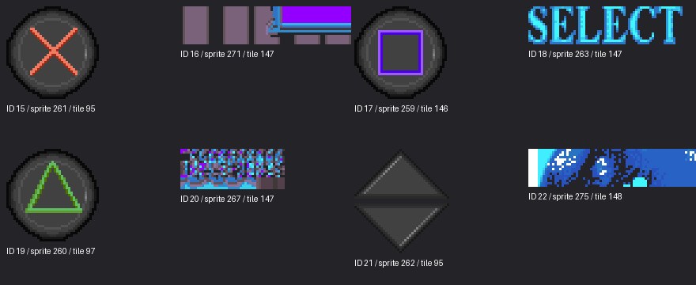

# Main menu reverse-engineering notes

## Camera Z bounds ruled out as the scale discrepancy

`FUN_00452fa0` initializes the camera's Z limits to `-800000` and
`800000`. The observed reference Z `-10000` already lies within them, so
the clamp in `FUN_00453190` does not move this initial camera closer.
The focal-scale constants were also checked directly in `Game.run`:
addresses `004b8e08/004b8e0c` contain floats 240 and 448, respectively,
matching the current 480/240 and 640/448 scale ratios. Neither replacing
these constants nor adjusting Z to a guessed minimum is supported by this
evidence. The missing behavior remains in controller/camera transitions.

## Confirmed initial menu control flow

Raw bytecode of function 5 state 6 ends with `push 7; opcode 0x37; 0x00`
at file offsets `0x1398..0x139c`. Thus entering state 7 is explicitly
requested by the original program, not an accidental scheduler fall-through.
That initialization sets local byte offsets `0x20` and `0x22` to zero,
selects sign animation 59, and sets the observed distant camera reference.
State 7 includes keyboard-configuration setup but also the main sign
selection dispatcher; it should not be described as exclusively a
configuration screen. X11 Down-release followed by Enter changes local
`0x20` from 0 to 1 and reaches sign animation selections 60 and 64.
The remaining camera discrepancy requires native controller/camera host
behavior; forcing a different initial SOOL state would contradict the COD.

## Configuration input trace after command `0x5c`

After implementing the four reference writes, an X11 Backspace injection
does not leave function 5 state 7. The trace polls Enter (`0xaa`, scan 28)
and arrow release queries; it never reaches the Backspace query during
this run. Therefore the scan-14 escape is a conditional path, not an
unconditional exit from state 7. The state dispatch loop at `0x142c`
returns to block offset `0x11fc`, which starts the keyboard/action polling
body. Verify arrow selection and its local offsets `0x20/0x22/0x4a` before
assuming a missing Backspace event explains the stalled navigation.

## Current script wait after startup

The live function-5 trace settles in state 7 at block offset `0x142c`.
That state's entry calls command `0x5c` with four function/local references
for keyboard configuration, then maps four values to keyboard scan codes.
Near file offset `0x1816` it polls variable `0xaa` with scan code 14
(Backspace), sets local offset `0x4a`, and enters the selector dispatcher
at `0x142c`. Thus an Enter test alone does not exercise this escape path.
The Linux scan-code bridge now includes Backspace. Command `0x5c` is still
unimplemented, so the configuration locals do not yet receive their native
values. Recover `FUN_004142a0` before treating this state as normal menu
navigation.

## Keyboard variable edge semantics

Assembly for `FUN_0040f2b0` (variable `0xaa`) returns raw keyboard byte
`DAT_004f59c0[scan] & 0x80`. `FUN_0040f300` (variable `0xab`) returns the
corresponding byte at `DAT_004f58c0`. Its producer `FUN_0043f590` computes
`(previous XOR current) AND previous`; thus `0xab` reports key release,
not initial key press. The Linux host now preserves this distinction and
updates release edges once per script update, shared by all function contexts.

## Menu scheduling: no separate condition programs

Inspection of all 24 headers in the mounted `option.cod` shows
`conditions_start == 0xffff` for every function. The separate condition-PC
path exists in the engine (`FUN_00421cc0` copies header `+8` into context
`+0x7e`), but it does not explain this menu's missing updates.
The relevant path is the persistent state-body PC at context `+0x7c`.
`FUN_004219b0` runs its state instructions in bounded bursts each engine
update. Opcode `0x32` clears the burst flag (mask 8), increments that PC,
and yields until the next update; it does not reset the function or finish
the state. The native port currently loses this continuation because its
state executor owns a temporary PC and local call-return bounds. Reproduce
that persistent continuation before scheduling menu states every frame;
restarting their bodies would repeat constructors and initialization.

## Native skeletal frame timing

`FUN_00484b40` reads the first signed word from the active decoded frame.
With animation speed at context `+0x26` equal to zero, duration is that
word shifted left by five in the native animation clock. With nonzero speed,
it first computes `(frame_word * speed) >> 12`, then shifts left by five.
`FUN_00484790` subtracts elapsed durations, advances the frame buffers,
and interpolates the remaining interval using a 16-bit fraction.
The engine clock is incremented by `FUN_00478360` as
`DAT_004e89e4 * DAT_004be2e8`; its relationship to SDL milliseconds still
needs confirmation before introducing native-rate playback.

The first-pose capture now shows only two visible sign boards, rather than
all neutral boards. No pose-application errors were logged. This confirms
that the decoded scale/rotation channels materially affect the intended menu
geometry; the current implementation still holds that first pose.

## Sparse animation frame validation

The bounded frame decoder successfully consumed every part pose in all
135 frames of selectors 57–70 in the French menu BIB. Selectors 57–64
contain ten-part signpost animations; 65 and 66 contain fourteen-part
dancers; 67 contains the fifteen-part pianist; 68–70 contain thirty-three
part Lucky Luke animations. The selected signpost animation 59 has three
frames. Its first frame rotates parts 5–8 by 2048 angle units and includes
scale channels; this is not equivalent to the neutral assembled geometry.
The leading frame words vary (for example 3 for the signpost, 10 for the
first dancer frame, 5 for Lucky selectors 68/69), so playback must recover
their native timing semantics rather than advance frames at a fixed rate.

## Corrected BIZ pixel-page selection

Following the loader resolves the previously suspected palette discrepancy:
`FUN_0044b320` replaces sprite word `+0x0e` through the page registry at
`DAT_004d1e70 + index*32 + 0x1a`. It is the sprite's pixel-page selector,
not a separate palette identifier. Tile `+0x0c` selects the palette page.
The old decoder incorrectly sampled both pixels and CLUT from the tile's
page. The native decoder now samples sprite pixels from sprite `+0x0e`
while retaining tile-page CLUT lookup. Earlier palette-identifier discussion
above describes an intermediate hypothesis superseded by this loader evidence.

## Palette selection discrepancy in the native BIZ decoder

The native RGBA decoder currently treats tile words `+0/+2` as the palette
coordinates. The original textured primitive constructor instead obtains
its color lookup identifier through `FUN_00470bd0`, which resolves the
BIZ object to its sprite and returns sprite word `+0x0e`. The texture page
identifier separately comes from tile `+0x0c` through `FUN_00470c20`.
For signpost material objects 115 and 117, both use tile 101 (tile words
`0,106`), but their sprite color lookup identifiers are respectively 5 and
6. The current decoder therefore cannot distinguish their palette selection.
This is concrete evidence of an incomplete palette path; resolve these
lookup identifiers through the original texture upload/palette code before
attempting color correction through channel swapping or lighting changes.

## Neutral assembly capture

The X11/Xvfb capture after neutral pivot assembly shows a coherent standing
Lucky Luke silhouette and a vertical signpost with multiple separate arrow
boards. This is a visible improvement over the raw vertex submission and
supports the neutral hierarchy assembly. It still does not reproduce the
reference menu: models are too small, all the signpost's neutral boards are
visible, their sampled textures appear predominantly blue, the western
background is absent, and no animation runs. The asset geometry path is
therefore usable for further diagnosis but not complete.

## Confirmed animated-part transform path

`FUN_00481de0` walks the DWORD stream at descriptor `+0x28`, bounded by
descriptor `+0x24`. Entries `0xfffffffd`, `0xfffffffe`, and `0xffffffff`
invoke matrix-stack helpers; other entries select a 40-byte expanded part.
The part pivot pointer at expanded offset `+0x10` supplies the translation
from an already transformed vertex. The animation flags are at expanded
offset `+0x14`; these are separate from source byte `+8`, copied to expanded
offset `+0x15` by the loader. Source byte `+8` must not be used as pose flags.

Flag bit 0 builds a rotation through `FUN_0047c630`, and the normal vertex
path calls `FUN_0047f6d0`. Bits 1/2 select translated or scaled variants;
the scale channels are signed values added to `0x1000`. Consequently,
assembling parts solely in directory order with pivot addition would skip
the explicit matrix-stack program and would not reproduce animated poses.
The next implementation must decode this DWORD hierarchy stream together
with the expanded animation channels before replacing raw vertices.

## Model-part directory validation

The bounded part reader was exercised on all five type-1 menu models.
It returns 10 parts for `PANCART2FR3DK`, 14 for each dancer, 15 for
`PIAN3DK`, and 33 for `LUCKY3DK`, with valid vertex ranges and pivot indices.
Lucky's chain starts with ranges `0+1`, `1+1`, `2+11`, `294+21`,
`273+21`, `235+38`, with pivots `0,0,1,2,294,273` respectively.
This supports a hierarchical part interpretation: most pivots reference
vertices belonging to earlier parts, rather than a single global model
origin. The neutral assembly still needs confirmation against the native
part-transform routine before adding these pivot positions to vertices.
Drawing the raw vertex stream directly does not establish a valid bind pose.

## Corrected SOOL startup-state semantics

The header word `inti_state_nb` at function offset `+10` is a single state
index, not a count or the upper bound of an initialization list.
`FUN_00421930` copies it into context `+0x72` (pending state), sets the
pending-state flag at `+0x74`, and disables execution when the index is
`0xffff`. `FUN_004219b0` installs that index as the active state through
`FUN_00421c20`, then `FUN_00421d00` selects its bytecode offset.
Thus function 5 starts at state 6 and function 23 starts at state 3.
Earlier descriptions below referring to multiple initial states should be
read as the raw header value, not as an execution list.

After this correction the native startup still creates thirteen BIB/BIZ
instances and selects camera reference `(21000,-3800,-10000)`, pitch 39,
yaw -144, projection 768. The previous opcode `0x02` startup warnings
disappear because their containing states are no longer executed spuriously.
This validates startup selection only; persistent script updates and the
complete host callback semantics remain incomplete.

## Native perspective capture status

An X11/Xvfb capture after connecting the decoded poses and camera shows
the signpost and character clustered near the center, at a much smaller
scale than the original screenshot. The image is therefore evidence of
projection submission, not a faithful menu reconstruction. In this run the
selected camera reference is `(21000,-3800,-10000)`, while the signpost pose
is `(30000,-144,28927)`. The startup runner executes several initial states
of function 5 independently; which camera state should be active in the
interactive main menu is still unresolved. Avoid compensating this mismatch
with an arbitrary focal-length multiplier. Recover state selection and the
native camera update path before calibrating object scale.

## Scene placement is supplied by command `0x2e`

The provisional renderer's descriptor anchors are insufficient to place the
animated objects. Registry `FUN_004145c0` maps command `0x2e` to
`FUN_00411400`. That handler resolves the current script object's descriptor
through `FUN_00407580`, looks up a pose using arguments 2 and 3 in
`FUN_00473140(DAT_004f1804, group, index)`, then passes the first three DWORDs
to `FUN_00411c90` and the next three DWORDs (narrowed to signed shorts) to
`FUN_00411680`. The position path reaches `FUN_00411d00`, which overwrites
descriptor XYZ at `+0x90/+0x94/+0x98`.

This is a concrete missing source of world positions and orientations, not
a scale discrepancy to fix by multiplying local anchors. `DAT_004f1804` is
the ten-entry registry allocated by startup command `0xf0` in
`FUN_00416550`. `FUN_00473140` searches its registered group IDs at record
`+4`, follows the group's offset directory, and returns its indexed pose.
Recover the registry population and pose source before calibrating the
camera against the provisional local-anchor render.

## Camera matrix detail recovered from `FUN_0047ca90`

The original view matrix is not a pure rigid camera transform. After
`FUN_00482a90` builds its nine signed fixed-point coefficients, the builder
scales coefficients 3, 4, and 5 (the entire second row at addresses
`00508186..0050818a`) by `0x170 / 512`, or `0.71875`.
For negative products it adds 511 before the arithmetic right shift by nine,
so this operation truncates toward zero. This vertical scale must be applied
before computing the inverse translation; applying a conventional OpenGL
camera rotation alone will not reproduce the original projection.

`FUN_00482760` then computes `q = (R * camera_position) >> 12` using that
scaled matrix. The builder stores translation `(-q.x, -q.y, depth_offset-q.z)`
through `FUN_00482a50`, then installs the matrix with `FUN_004824a0`.
The separate `depth_offset` argument and the camera position supplied by the
scene wrappers remain necessary inputs; the SOOL reference XYZ by itself
does not specify this complete matrix. These findings are not yet applied to
the provisional orthographic menu renderer.

This note records what can be established from the decompiled `Game.run`,
installed game files, and the observed menu screenshot. Ghidra function names
are retained because original symbols are unavailable. File offsets and runtime
traces are not yet recorded for every observation; inferences are labeled.

## Startup sequence and movies

The application entry path reaches `FUN_004067e0`, which initializes AVI
support and the game subsystems. Its static call path invokes
`FUN_00404be0("IMAGE\\T15HZ.AVI")` before the logo/image routines. The
installed T15HZ clip is 640x480 at 15 fps and about six seconds long, with
Indeo 5 video and mono 22.05 kHz PCM audio. The binary then loads startup
images including `APLOGO.PCX` and a language-specific `LI_*.PCX` from
`win/graphics/FONT.KXP`. This order is what the static startup code shows;
launcher behavior can add earlier logos outside `Game.run`.

`FUN_00404be0` is the AVI player. It opens the AVI, enumerates video and audio
streams, obtains video frames with `AVIStreamGetFrame`, reads sound samples
with `AVIStreamRead`, and queues them to `waveOut`. It is not a BIB/BIZ scene
loader.

The logo path is now traced one step further. `FUN_004067e0` calls the image
loader with `aplogo.pcx` and presents it before selecting one of `li_en.pcx`,
`li_fr.pcx`, `li_ge.pcx`, `li_sp.pcx`, `li_it.pcx`, `li_du.pcx`, or `li_br.pcx`
from the configured language. `FUN_00449bc0` recognizes their `.pcx` suffix
and resolves these names from `win\\graphics\\font.kxp` using the key `lucky`, decodes the selected image,
creates a surface at the PCX dimensions, and presents it. The call sites pass
`(5, 10, 1)`. `FUN_00449bc0` counts display-loop iterations to a maximum of
`10 * 60`; input can end the display after `5 * 60` iterations. The Linux
implementation follows this timing and archive-member path, loading and
presenting the first member before attempting the localized member. It does
not need loose copies of the logo PCX files.

The surface placement is also visible in the decompilation. `FUN_0043ff20`
creates a surface using the current display width and height, and the logo
call passes flags `1` (not the `2` centering flag handled by that function).
`FUN_004408d0` copies the PCX rows into the surface starting at its origin.
The native presentation therefore keeps the PCX at its original pixel size at
`(0, 0)` instead of scaling and centering it; uncovered screen area is cleared
to black as a practical equivalent for the surface's unused area.

The format dispatch is explicit: `FUN_00449b60` tests the `.pcx` suffix,
then `FUN_00435000` opens `FONT.KXP` and `FUN_00431fe0` decodes the extracted
member. The game decoder accepts either 8-bit indexed images (one plane plus
the trailing 256-color palette) or 24-bit RGB images (three planes). The
native PCX reader now implements both layouts with bounded RLE and palette
access. The checked-in Aqua Pacific logo is the 24-bit, three-plane case.
`FUN_00431fe0` shifts each decoded channel down to five bits before packing
the original 16-bit surface pixel; the native reader mirrors that color
precision when expanding to RGBA for OpenGL. Pure black is emitted with zero
alpha, matching the original pixel's clear high bit when RGB is zero.
This confirms that `Game.run` reads the logo bytes from KXP at runtime rather
than embedding them in the executable.

I verified the reader against the mounted CD's `win/graphics/FONT.KXP`:
`APLOGO.PCX` extracts to a 512x256, 93,367-byte PCX and is byte-for-byte
identical to `assets/startup/aplogo.pcx`. The same archive contains all seven
language members used by `FUN_004067e0` (`LI_EN`, `LI_FR`, `LI_GE`, `LI_SP`,
`LI_IT`, `LI_DU`, and `LI_BR`); each extracts as a 512x256 PCX. The native
startup path therefore reads the installed archive directly and does not
depend on the checked-in copy. `scripts/extract_kxp.py` follows the same KXP
header, index, member-header, and payload-decryption layout for offline
inspection.

The archive open path (`FUN_00435000`) reads `KXP`, version 1, the index offset
at `0x25`, and an `I` index with 16-bit member count and 17-byte records. When
byte `0x05` is nonzero, the game XOR-decodes bytes `0x05..0x24` with the
repeating key passed by the caller, then compares the result against a fixed
32-byte discriminator in `Game.run` at VA `0x004b62e0`; only then does it mark
the archive encrypted. This header check uses unconditional XOR and is distinct
from the payload decoder's conditional XOR with key `lucky`. Member lookup
(`FUN_00435670`) matches the 13-byte name, reads
the member size at payload-header offset `+5`, skips the 9-byte member header,
and conditionally applies XOR to the payload, preserving zero bytes and bytes
equal to the current key byte. `FUN_00431fe0` then decodes PCX RLE and converts
indexed palette pixels into 16-bit colors; `FUN_004408d0` copies those pixels
to the display surface. The Linux KXP reader and offline extractor reproduce
the header's unconditional XOR before validating the discriminator. This
matters for the encrypted `FONT.KXP` on the supplied CD: a direct comparison of
its stored header bytes incorrectly rejects it.

The main-menu state can play `IMAGE\\I12HZ5m.AVI` on the intro path and
`IMAGE\\O12HZ5m.AVI` when returning to the menu, gated by the presentations
setting. The intro is 640x384, 12.5 fps, about 164 seconds, with Indeo 5 video
and mono 22.05 kHz PCM. The outro clip is 640x480, 12.5 fps, about 69 seconds,
with Indeo 5 video and stereo 22.05 kHz MS ADPCM. `FUN_004056d0` logs movie
playback and toggles sound around some transitions.

## Menu state, scene, and rendering

`FUN_00404f60` initializes the current state (`DAT_004e8914`) to 1.
`FUN_00405350` maps state 1 to `CINEMA/OPTION/option.cod`. The executable
loads three distinct resources for this state: `option.cod`, a localized
`option_<language>.biz`, and a localized `option_<language>.bib`. In
`FUN_004056d0`, the root `\\Cinema\\Option\\Option` is given the `.BIZ`
extension and passed to `FUN_0044baa0`; then `.BIB` is appended to a copied
scene stem, and `FUN_004658d0` loads the BIB into `DAT_004e8820`.
`FUN_004052b0` conditionally trims a two-character suffix for a defined set
of non-menu states; the menu state is not in that set, so its language suffix
is retained. The COD path is separately selected by `FUN_00405350` and
registered with the SOOL runtime.

The installed `option.cod` is 14,277 bytes and starts with `SOOL`. Its
DWORD at offset 4 is `0x37c5` (the file length), and the WORD at offset 8 is
`0x18` (24). `FUN_00420d10` reads a 24-entry, 8-byte-per-entry table starting
at file offset `0x0a`, then exposes it as three contiguous arrays of 24
4-byte, 2-byte, and 2-byte elements. In this file, the first array contains
increasing offsets to 24 function blocks; the two 2-byte arrays are all zero.
All offsets are inside the file, and each function block begins with eight
16-bit header fields. `FUN_00422b50` prints their engine field names:
`data_start`, `code_start`, `virtual_start`, `virtual_nb`,
`conditions_start`, `inti_state_nb` (the engine's diagnostic spelling),
`code_end`, and `states_nb`. For all 24
blocks, `code_end` equals the distance to the next block (or EOF for the last
one), validating the table and block boundaries. Most virtual/condition
fields are `0xffff` or zero. Block 5 at `0x422` declares initial state index 6
and eight states; block 23 at `0x2c57` declares initial state index 3 and seven
states. This reveals the SOOL program's function/state organization. The first
blocks' initialization commands are decoded below; most later states still
need their command arguments and visual roles identified.

The interpreter's command path is identified and bytecode from several states
has been statically decoded. Startup installs three SOOL callbacks with
`FUN_004223c0`: variable lookup (`FUN_00420ad0`), command dispatch
(`FUN_00420a40`), and file reads (`FUN_00420c00`). The state-bytecode runner
`FUN_00424330` routes bytecode classes `0x3c`–`0x4a` through the command
dispatcher and classes `0x50`–`0x5e` through variable lookup. The dispatcher
reads a command ID from the current SOOL argument frame and calls its handler
in the registered command table. The command classes encode how many stack
values are consumed; literals and state boundaries are enough to recover the
calls in the examples below. Full control-flow and variable interpretation
across every state is still incomplete.

The initial state of function block 0 is now decoded. Its state-offset entry
is `0x12`; starting there, the bytecode pushes command IDs and invokes them
through class `0x3c`–`0x3f`. Command IDs are the top stack value, and the
handler reads arguments below it. This state calls `0xb9`, `0xf0`, `0xe6`,
`0x1e`, `0x36`, `0x70`, `0xc8`, `0xd0`, `0xa1`, and `0x4d` in that order.
These IDs resolve through the command registry (not the separate variable
table):

| Command | Handler | Stack values consumed, bottom to top | Verified effect in this state |
| ---: | --- | --- | --- |
| `0xb9` | `FUN_00416120` | `0xb9` | Installs a callback and initializes shared scene state. |
| `0xf0` | `FUN_00416550` | `0xf0` | Allocates and zeroes a 10-element `DWORD` array. |
| `0xe6` | `FUN_00416190` | `0xe6` | Calls `FUN_00456ce0(10, 10)` and stores its result. |
| `0x1e` | `FUN_00410740` | `0x1e` | Loads a table through `FUN_00477aa0`. |
| `0x36` | `FUN_00411d90` | `0x180, 0x300, 0x1, 0x36` | Sets two globals from handler arguments `1` and `0x300`; the dispatcher also consumes `0x180`. |
| `0x70` | `FUN_004188d0` | `0x19c, 0x70` | Sets a numeric scene parameter to `0x19c` (412) and recalculates its digit-derived fields. |
| `0xc8` | `FUN_004172b0` | `0, 0xc8` | Sets the audio sample-index base to `0`. |
| `0xd0` | `FUN_00417580` | `0x258, 0xd0` | Sets the digital-sample volume multiplier to `0x258` (600). |
| `0xa1` | `FUN_004186f0` | `0, 0xa1` | Sets a scene flag to `0`. |
| `0x4d` | `FUN_00413a80` | `1, 0x4d` | Sets `DAT_004f1765` to `1`, a flag required by `FUN_00406210` before it processes input. |

The audio effects are particularly useful: `FUN_0040d3e0` subtracts the
sample-index base when resolving a digital sound, while `FUN_00420580`
multiplies each sample volume by `DAT_004d238e / 256` and caps it at
`0x3fff`. So the initial menu state explicitly configures the digital effect
bank and a `600/256` volume scale. This is separate from CD audio. The `0x4d`
command sets `DAT_004f1765` to `1`, a flag required by `FUN_00406210` before it
processes input. Between the `0x70` and `0xc8` commands, the state also reads
variable ID `0xb6` with context `0` and discards the result. The exact meaning
of that value and the keys that choose the visible signs are still unresolved.

The block directory extracted from the French `option.cod` is:

| Function | File offset | `code_end` / block size | `code_start` | `inti_state_nb` | `states_nb` | State offsets (block-relative) |
| ---: | ---: | ---: | ---: | ---: | ---: | --- |
| 0 | `0x0ca` | `0x61` | `0x12` | 0 | 1 | `12` |
| 1 | `0x12b` | `0x28` | `0x12` | 0 | 1 | `12` |
| 2 | `0x153` | `0x2d` | `0x12` | 0 | 1 | `12` |
| 3 | `0x180` | `0x1e8` | `0x1c` | 0 | 2 | `1c, 179` |
| 4 | `0x368` | `0xba` | `0x16` | 0 | 3 | `16, 1b, 1c` |
| 5 | `0x422` | `0x14a0` | `0x54` | 6 | 8 | `54, 181, 2c9, 4dc, 832, e85, eb7, f7b` |
| 6 | `0x18c2` | `0xd8` | `0x18` | 0 | 2 | `18, 4f` |
| 7 | `0x199a` | `0xd8` | `0x18` | 0 | 2 | `18, 4f` |
| 8 | `0x1a72` | `0xa6` | `0x18` | 0 | 2 | `18, 1d` |
| 9 | `0x1b18` | `0xd8` | `0x18` | 0 | 2 | `18, 4f` |
| 10 | `0x1bf0` | `0x9e` | `0x14` | 0 | 2 | `14, 5b` |
| 11 | `0x1c8e` | `0x2e1` | `0x1c` | 0 | 2 | `1c, 9c` |
| 12 | `0x1f6f` | `0x208` | `0x2a` | 0 | 2 | `2a, 2f` |
| 13 | `0x2177` | `0x1f0` | `0x26` | 0 | 2 | `26, 2b` |
| 14 | `0x2367` | `0x1a8` | `0x1e` | 0 | 2 | `1e, ec` |
| 15 | `0x250f` | `0xf4` | `0x16` | 0 | 2 | `16, 46` |
| 16 | `0x2603` | `0x124` | `0x18` | 0 | 2 | `18, 5e` |
| 17 | `0x2727` | `0x9c` | `0x16` | 0 | 2 | `16, 46` |
| 18 | `0x27c3` | `0xbc` | `0x18` | 0 | 2 | `18, 5e` |
| 19 | `0x287f` | `0xf4` | `0x16` | 0 | 2 | `16, 46` |
| 20 | `0x2973` | `0x124` | `0x18` | 0 | 2 | `18, 5e` |
| 21 | `0x2a97` | `0xc8` | `0x16` | 0 | 2 | `16, 46` |
| 22 | `0x2b5f` | `0xf8` | `0x18` | 0 | 2 | `18, 5e` |
| 23 | `0x2c57` | `0xb6e` | `0x30` | 3 | 7 | `30, da, 1b9, 1dc, 54e, 56f, 5af` |

The state-offset table starts immediately after each 16-byte block header and
contains `states_nb` little-endian 16-bit offsets relative to that block.
`FUN_00421d00` selects an offset for the active state, and the bytecode runner
uses it as the program counter from the beginning of the block. Every state
offset falls within its block; the first state offset equals `code_start` in
all 24 blocks. This is enough to split the script into bounded per-state
segments. Command arity and literal arguments can be recovered, though values
that depend on variables or branches still need control-flow interpretation.

The initial state of function block 2 calls command `0x64` at block offset
`0x1c`, with stack values `[2, 12, 0x64]`. The registry maps it to
`FUN_0041a680`. That handler takes `12` as a BIB resource selector and resolves
it through offset-table entry 12 to file offset `0x120`, the `3DX` catalogue.
It reads the catalogue dimensions and builds geometry lists from its records.
This statically links the option script to the 3D catalogue; individual model
records and their scene transforms remain unresolved.

Function block 3's initial state calls command `0x122` with pushed values
`[140, 3, 0x122]`. Since `FUN_004074b0` reads arguments backward from the
stack top, `FUN_00415a60` passes 140 to `FUN_00446390` and stores instance ID
3 in the callback-backed object. The allocator creates a 20-byte state and
stores `-((140 << 8) / DAT_004be3cc)` at state offset `+0x10`. The same block
invokes commands `0x123`–`0x126`, plus `0x128` and `0x12c`; these are not the
3DX catalogue loader and operate on BIB/BIZ-backed sprite and primitive data.

The decoded call arguments clarify the selectors. Command `0x123` passes a
child index and a BIB offset-table index to `FUN_00446b90`; in this call the
child is `local[0x16]` and the BIB table index is 15 (offset `0xb4` in
`option_f.bib`). The routine resolves the BIB entry, consults the active BIZ
sprite/tile tables, and submits either two mapped primitives or one clipped
quad, depending on the parameters.
Command `0x124` updates two child-associated primitive records tagged `0x28`;
`0x125` updates two records tagged `0x38`. Both write coordinates and
per-record bytes. Command `0x126` stores a raw short and two values scaled by
`256 / DAT_004be3cc` on the selected child. Command `0x128` sets a child flag
and a mode byte, while `0x12c` writes another child byte field.

The initial-state calls and arguments (excluding each command ID) are shown in
SOOL push order, from the first pushed value to the command ID at the top:

- `0x122` at file offset `0x1a6`: `[140, 3]`.
- `0x124` at `0x1eb`: `[20, 0, 0, 140, 512, 156, 0, local[0x14]]`.
- `0x125` at `0x218`: `[130, 0, 0, 20, 0, 0, 110, 512, 156, 0, local[0x14]]`.
- `0x124` at `0x23c`: `[16, 48, 64, 180, 512, 406, 0, local[0x14]]`.
- `0x126` at `0x24f`: `[0x100, 0, 0, 0, local[0x14]]`.
- `0x123` at `0x293`: `[80, 80, 0, 0, 56, 80, 144, 406, 15, local[0x16]]`.
- `0x126` at `0x2a6`: `[240, 64, 0, 0, local[0x16]]`.
- `0x124` at `0x2db`: `[255, 255, 255, 256, 512, 0, 0, local[0x18]]`.
- `0x128` at `0x2e8`: `[1, 2, local[0x18]]`; `0x12c` at `0x2f2`:
  `[0, local[0x18]]`.

The values in `local[0x14]`, `local[0x16]`, and `local[0x18]` are read from
SOOL locals at execution time; the script does not provide their literal
values in this state. Because the handlers read from the top of the stack,
the first two `0x124` calls and the `0x125` call select child `local[0x14]`;
the final `0x124` call and both `0x128`/`0x12c` calls select `local[0x18]`.
The two `0x126` calls select `local[0x14]` and `local[0x16]`. This proves
which child/BIB selectors and fixed parameters are submitted, but instance 3
and its records are still not matched to visible items.

The instance-3 object installs `FUN_004490f0` and `FUN_00449200` as its
callbacks. The first derives a base screen position from viewport dimensions
and two angle-driven values, then transforms active child records and advances
their animation data. The second is gated by renderer/state flags, iterates
active children, and passes them through `FUN_00448a40` to prepare their
primitive submissions. This is a callback-driven sprite/primitive container,
separate from the `3DX` catalogue loader. Its link to a visible menu element
is still unknown.

The child list can be populated through a separate SOOL variable callback,
but the installed block-3 script does not show that callback being invoked.
`FUN_0040d180` registers variable ID `0x50` to `FUN_0040ca80`; the callback
reads five values from the current SOOL frame and calls `FUN_004471b0` on the
current object's state pointer. `FUN_004471b0` allocates and links a 0x40-byte
child record, then increments the parent's child count at `+0x12`. The
instance-3 constructor `FUN_00446390` initializes that count to zero. However,
neither bounded state of block 3 contains an instruction in the interpreter's
variable-lookup class range `0x50`–`0x5e`. Its first state directly issues the
`0x123`–`0x12c` handlers, which look up existing children and do not create
them. This leaves a real unresolved point: either another engine/script path
populates this instance's list, or these configuration calls find no child
and have no effect. The runtime object identity and child count need tracing
before these calls can be connected to visible menu elements.

The BIZ layout is partly recovered from `FUN_0044b320`. Its first DWORD is an
offset to a seven-DWORD header. For the French menu, the offset is 8 and the
header values are `0x132` objects, `0x117` sprites, `0x95` tile records, and
14 texture pages (the remaining three values are zero). The arrays follow the
header: 4 bytes per object, 20 bytes per sprite, and 16 bytes per tile. Fourteen
packed pages of `0x8000` bytes follow. The end of those pages is `0x72408`,
which matches the second BIZ DWORD and is used by `FUN_0041ebe0` as the offset
to the sound table. Page data is unpacked from 4-bit values and uploaded to the
renderer; `FUN_0044aaa0` sets up palette/decoded pixel data.

The BIZ load then calls `FUN_00441560`, which adds the title/options overlays
to the same texture-page pool. When `DAT_004e8914 == 1`, it loads
`win\\graphics\\keys.kxp` and selects the keycap PCXs according to
`DAT_004e8750`: the first branch requests `key_v`, `key_b`, `key_g`,
`key_c`, and `key_f`; the alternate branch requests `key_down`, `key_rite`,
`key_up`, `key_left`, and `key_f`. The destination page IDs are passed to
`FUN_00432a70`, which resolves each PCX against the active BIZ sprite/tile
metadata before `FUN_00432510` decodes it into that texture page. This confirms
that the menu's key legend is assembled from runtime assets and the configured
keyboard layout. `FUN_00428600` reads the setting named `Keyboard Hand` into
`DAT_004e8750`, and the same flag selects between the two PCX sets here and
the two action tables in `FUN_0045ee90`. Thus the art follows the active
keyboard mapping; this still does not show which keys change the two 3D sign
choices.

For the same menu state, `FUN_00441560` also inserts localized control and
configuration labels from `win\\graphics\\fixgfx.kxp` (including French
`manette.pcx` and `motde.pcx`), plus `default.pcx`, `wood.pcx`, `wanted.pcx`,
and `moon.pcx`. These are placed into texture pages 13, 0, 12, and 6
respectively; `wood.pcx` and `moon.pcx` are written at page coordinates
`(128,247)` and `(79,0)`. It also loads `win\\graphics\\handed.kxp` into page
14 for the handedness graphics and cross marker. The mouse image is loaded
separately from `win\\mouse.pcx` into page 15. These calls prove the resource
and page placement used by the menu renderer, while the scene draw determines
which assets appear in a particular screenshot.

The BIB is an indexed data resource used by many animation/object handlers.
In the installed `option_f.bib` (size `0x29000`), DWORD 0 is `0x25528`, the
file offset of an embedded `SOOL` block. This menu BIB has 71 DWORD selectors occupying
`[0x04,0x120)`; each handler resolves its resource by adding the stored
relative offset to the BIB base. The value in selector 12 is `0x120`, where a
grid preamble begins. Its `3DX\0` catalogue starts 16 bytes later, at `0x130`.
This disproves the earlier `BIB\0` signature and fixed 19-byte object-record
format.

The native parser locates the aligned 3DX grid root and uses its position to
derive the variable selector-table length (71 entries in this menu BIB). It
preserves bounded selector sections and validates the `3DX` header and record
bounds. The catalogue header gives 42 records of 24 bytes, beginning at `0x140` and ending
at `0x530`; its data-base field is `0x1f6c8`. Each record contains a 16-byte
name and a descriptor reference measured in four-byte units from the enclosing
grid section at `0x120` (the `3DX` tag itself is at `0x130`). The parser
resolves all 42 references and decodes each descriptor's parent link, 8-byte
vertex records, geometry-group chain, primitive records for types 0–3, 12.4
orientation basis, anchor, and local bounds. It also parses the SOOL
script-offset directory and animation-table offset lists. Script instructions
and packed animation payload opcodes remain raw data.

The BIB also contains readable scene/resource identifiers. In the French
file these include `OPFOND1`, `OPFOND10`…`OPFOND12`, `OPMAISON01`,
`PANCART2FR3DK`, `LUCKY3DK`, `DANS013DK`, `DANS023DK`, and `PIAN3DK`.
The localized sign identifier changes to `PANCART2AN3DK` in the English file
and `PANCART2AL3DK` in the German file. This is direct evidence that localized
sign art and named scene objects are in the BIB resource. The identifiers and
catalogue records connect the signpost and Lucky Luke models to original scene
resources; they do not by themselves recover every model-local transform or
prove the exact per-frame rendering path.

The complete 42-entry catalogue in the French menu file is:
`OPFOND1`, `OPFOND10`, `OPFOND11`, `SFCRASH`, `BARRIL`, `SOL` (four
records), `SOL0` (four records), `SFLAMPE`, `FEUILLE1`, `SA_ETAGE`,
`OPMAISON01`, `BLOC077`,
`GRFOIN`, `MANGEOIR`, `B4_SHERI00`, `MANGEOIR1`, `B5_PRISON`, `B7_BACG01`,
`CHARETTE`, `BARIER2`, `BARIER1`, `BARIER11`, `MANETTE`, `SA_TABLE02`,
`BARIER3`, `BARIER31`, `CAISSE1`, `CAISSE21`, `GRFOIN0`, `OBJECT06`,
`OPFOND12`, `PANCART2FR3DK`, `DANS013DK`, `DANS023DK`, `PIAN3DK`, and
`LUCKY3DK`. These are literal catalogue identifiers; the interpretation of
their names as scenery, props, or animated characters is a naming-based
inference. They establish the breadth of the scene catalogue, but not that
every entry is visible in the captured menu frame.

One BIB offset-table entry makes the 3D link more explicit: table index 12
resolves to file offset `0x120`; the section starts at `0x130` with `3DX\0`.
The preamble at `0x124` declares grid dimensions `6 × 1 × 2`, followed by
coordinate factors `20000`, `10000`, and `23000`. `FUN_0041a680` reads those
dimensions into its grid bookkeeping and reads the factors into three
coordinate-step globals, negating the Y factor before applying position
corrections. The following `3DX` header fields in `option_f.bib` are 42
entries, a 24-byte record stride, and data-base field `0x1f6c8`. The catalogue
starts at `0x140`; each 24-byte record has a 16-byte name and two 32-bit
fields. `FUN_0041a680` resolves the first field in 4-byte units from the
`3DX` root at `0x120`, so `OPFOND1`'s value `0x104` points to a descriptor at
`0x530` (`0x120 + 0x104 * 4`), not directly to vertex data. That descriptor
stores its source position at `+0x90..+0x98`. For `LUCKY3DK`, catalogue value
`0x6ba0` resolves to descriptor `0x1afa0`. The descriptor type at `+1`
determines which list receives an object. `PANCART2FR3DK`, `DANS013DK`,
`DANS023DK`, `PIAN3DK`, and `LUCKY3DK` have type 1; `FUN_0041a680` places
them in a separate bucket at index 13, after the 12 spatial cells and one
reserved slot. `FUN_004799d0` iterates only indices 0 through 12, so it does
not process this type-1 bucket in its spatial-bucket pass. The menu script
does instantiate the five descriptors through a separate per-object callback
path, described below. Their stored positions are `(784, 0, 294)` and
`(270, -28, 297)`; type-1 objects bypass the type-0 spatial-cell correction,
so the earlier claimed cell `(0, 0, 0)` and corrected origins for these
objects were incorrect.

The `Select Perso` name is confirmed by the debug-menu registration in
`FUN_00458f00`. Its callback, `FUN_0045bfe0`, reads the type-1 bucket at index
`DAT_004e89fa`; Left/Right action bits (`0x80`/`0x20`) change the selected
entry, and other action bits adjust that model's coordinates and orientation.
This is an editor/debug object inspector, not the title-menu navigator. It
shows that the special bucket is browsable for debugging, but does not add a
normal frame-render consumer for its sign and Lucky descriptors.

Byte-level inspection confirms the type split across all 42 catalogue
records: 37 type-0 records and five type-1 records. The type-1 names are the
sign, both dancers, the piano, and Lucky. `FUN_0041a500` constructs a flat
pointer array for every bucket, including the type-1 bucket, but the regular
world update/draw callback's loop bound excludes bucket 13. The five SOOL
`0x65` constructors resolve exactly those same records and attach them
individually to the scene-object callback list, giving them a separate
ordinary frame-render path.

The four `OPFOND*` entries have type 0 and source `z=46970`. With the declared
Z step of 23000 and two Z cells, the coordinate helper returns `-1` for Z cell
2, so these entries are not inserted into the ordinary spatial-cell lists by
this loader path. Their presence in the catalogue alone does not prove that
they are drawn in this menu. The other 37 names also remain unverified as
visible objects. All 42 descriptor addresses are within the BIB file; the
separate data-base field, second catalogue field, and geometry/vertex encoding
remain unresolved.

The SOOL command registry provides a useful limit on possible load paths:
`FUN_0041bf20` registers command `0x69` to `FUN_0041b530`, which calls the
explicit BIB model setup routine `FUN_0041b3c0`. A search of the actual
`option.cod` bytecode finds no `0x69` invocation. The script does invoke BIB
command `0x65` (`FUN_00418030`) five times, at file offsets `0x12e8`,
`0x18e1`, `0x19b9`, `0x1b37`, and `0x1c0b`. Their literal resource-selector /
instance-ID pairs are `(52,5)`, `(53,6)`, `(54,7)`, `(55,8)`, and `(56,9)`.
`FUN_00418030` resolves the first value through `FUN_00418120`, then stores the
second as the scene-object registry ID and installs callbacks. The argument
order follows the SOOL stack: `FUN_00420a40` reads the command ID at argument
index 1, while `FUN_004074b0` indexes backward from the stack top.

In the French BIB, selectors 52–56 resolve to the five type-1 descriptors in
the 3DX catalogue:

| BIB selector | Instance ID | 3DX name | Descriptor offset | Stored XYZ |
| ---: | ---: | --- | ---: | ---: |
| 52 | 5 | `PANCART2FR3DK` | `0x17da0` | `(784, 0, 294)` |
| 53 | 6 | `DANS013DK` | `0x18aa0` | `(478, 0, 0)` |
| 54 | 7 | `DANS023DK` | `0x19754` | `(478, 0, 0)` |
| 55 | 8 | `PIAN3DK` | `0x1a408` | `(726, 0, 623)` |
| 56 | 9 | `LUCKY3DK` | `0x1afa0` | `(270, -28, 297)` |

Each resolved BIB offset exactly matches the address computed from its 3DX
catalogue record. This explains why the type-1 bucket need not be traversed by
the ordinary spatial-bucket draw loop: `FUN_00418030` creates one wrapper per
descriptor, and `FUN_0047ac50` submits eligible geometry through
`FUN_004803f0` on the per-object frame path. The visible sign and Lucky models
are connected to normal scene rendering; their exact animation timing and draw
ordering still need runtime confirmation.

The six signed 32-bit values at descriptor offsets `+0xa4..+0xb8` are used by
`FUN_0041a680` as three minimum/maximum coordinate pairs: the loader subtracts
each minimum from its maximum to get an extent, then uses those extents when
centering or orientation-correcting type-0 objects. Reading those fields from
the five type-1 descriptors gives these local bounding ranges in raw model
units:

| 3DX name | Local minimum (x, y, z) | Local maximum (x, y, z) | Extent (x, y, z) |
| --- | --- | --- | --- |
| `PANCART2FR3DK` | `(-784, -3921, -294)` | `(1960, 0, 0)` | `(2744, 3921, 294)` |
| `DANS013DK` / `DANS023DK` | `(-478, -1709, 0)` | `(376, 0, 42)` | `(854, 1709, 42)` |
| `PIAN3DK` | `(-726, -1538, -623)` | `(769, -4, 692)` | `(1495, 1534, 1315)` |
| `LUCKY3DK` | `(-270, -1728, -297)` | `(270, 28, 315)` | `(540, 1756, 612)` |

This establishes model-space sizes and helps explain why the screen-space size
cannot be read from the anchor coordinates alone. It does not reveal the mesh
vertices or prove the binary's unit-to-screen scale; the camera pose, model
animation, and driver projection are still needed for a pixel comparison.

The descriptor's `+0x44` field points to a model-data directory. Its first
four DWORDs are offsets relative to the descriptor base. `FUN_0047e8d0` uses
the first three to locate model payload regions and the fourth to locate the
typed-group headers; the precise roles of the first three regions are not
fully resolved. Each header is 20 bytes: type and
element count are 16-bit fields at `+0/+2`; expanded-record stride, source
stream advance, and output-record advance are DWORDs at `+4/+8/+12`. The
runtime links the headers through `+16`, and `FUN_0047ec50` stops when the
sum of group element counts reaches the descriptor's `+0x2c` total. The
descriptor's `+0x1c` value is used in scratch-buffer sizing; it is not the
group count (the earlier interpretation was incorrect).

For example, the French sign descriptor at `0x17da0` points to its directory
at `0x18624`; that directory's fourth DWORD is `0x4d0`, so the group headers
are at descriptor-relative address `0x17da0 + 0x4d0 = 0x18270`. Lucky's
descriptor at `0x1afa0` points to directory `0x1d324`, whose fourth DWORD is
`0xd88`; its group headers begin at `0x1bd28`. The header groups are therefore
not at `directory + fourth_DWORD`.

The first four group types dispatch as follows. Types 0 and 1 expand three-
and four-index elements into triangle and quad records with primitive codes 4
and 5. Types 2 and 3 carry a material/page selector and per-vertex color data;
their handlers resolve texture-page information and queue primitive codes 7
and 9. All four final handlers reject primitives when the projection/clipping
helper `FUN_00482db0` returns a negative result, then queue them through
`FUN_0047d910` for depth ordering and driver submission.

The source record layouts read by the handlers are:

| Type | Source stride | Indices | Other fields read | Queued record |
| ---: | ---: | --- | --- | ---: |
| 0 | 12 bytes | 3 × `u16` at `+0,+2,+4` | attribute `u32` at `+8` | 20 bytes, primitive code 4 |
| 1 | 12 bytes | 4 × `u16` at `+0,+2,+4,+6` | attribute `u32` at `+8` | 24 bytes, primitive code 5 |
| 2 | 20 bytes | 3 × `u16` at `+0,+2,+4` | material selector `u16` at `+6`; attribute `u32` at `+8`; three pairs of per-vertex bytes at `+12..+17` | 32 bytes, primitive code 7 |
| 3 | 24 bytes | 4 × `u16` at `+0,+2,+4,+6` | material selector `u16` at `+8`; attribute `u32` at `+12`; four pairs of per-vertex bytes at `+16..+23` | 40 bytes, primitive code 9 |

`FUN_0048d670` additionally proves that the type-2 corner byte pairs are
texture coordinates: it resolves the face's material through the model table
at descriptor `+0x3c` (four bytes per entry), compares the entry's first word
to a BIZ sprite ID, then subtracts that sprite's UV origin, returned by
`FUN_00470c70`, from each source corner pair at `+12..+17`. Thus these pairs
must be retained as UV bytes rather than interpreted as vertex colors.
The on-disk relocation of the descriptor's material table still needs to be
resolved before connecting face material indices directly to BIZ sprites.

Types 2 and 3 resolve the material selector through the active BIZ texture
metadata (`FUN_00470bd0` / `FUN_00470c20`) and carry two color/intensity
channels per corner. The handlers combine those values with shared shading
state before writing the expanded records. The exact meaning of every
attribute bit and the two per-corner channels is still under investigation.

Walking the actual group headers in the French BIB gives:

| 3DX name | Groups (type: elements) | Groups | Elements (`+0x2c`) |
| --- | --- | ---: | ---: |
| `PANCART2FR3DK` | `2:6, 1:18, 3:33` | 3 | 57 |
| `DANS013DK` | `2:27, 3:25` | 2 | 52 |
| `DANS023DK` | `2:27, 3:25` | 2 | 52 |
| `PIAN3DK` | `0:7, 2:8, 1:6, 3:22` | 4 | 43 |
| `LUCKY3DK` | `0:100, 2:213, 1:42, 3:70` | 4 | 425 |

These are typed source elements, not final triangle counts: each element is
projected, clipped, depth-sorted, and then submitted through a selected
renderer driver. The group headers now identify the sign and Lucky meshes as
mixtures of triangle/quad primitive types, including textured variants. The
precise interpretation of their material IDs and color fields, animation
changes, and the camera projection still need full recovery.

The descriptors also contain placement coordinates at `+0x90/+0x94/+0x98`.
The type-1 records retain these values, and `FUN_0047a5d0` derives the active
spatial cell from the same three fields; `FUN_0047ac50` then subtracts the
cell origin for rendering. These are therefore the scene's stored world-space
anchors, in engine units. The sign and Lucky anchors are `(784,0,294)` and
`(270,-28,297)`, respectively; the dancers share `(478,0,0)`, and the piano
uses `(726,0,623)`. They establish relative placement in the scene, but the
camera view transform, model-local origin, and projection are still needed to
project them onto the screenshot.

The menu script contains three calls to SOOL command `0x136`. The command
registry maps it to `FUN_0041c670`, which multiplies three coordinate
arguments by 100 and passes them with two angle arguments to
`FUN_0041c3e0`. That routine writes the scaled coordinates into the camera
subsystem's reference state. It clamps X and Y to the current scene bounds,
leaves Z at the supplied value, clamps the first angle to `[-800,800]` and
the second to `[-1600,1600]`, then installs a camera-update callback. The
later view-matrix builder treats the resulting XYZ as the camera's
world-position input; it applies the orientation and a separate depth offset
when constructing the world-to-camera transform.

| `option.cod` file offset | Block-relative offset / state | Values pushed, bottom to top | Reference XYZ after ×100 | Angle arguments |
| ---: | --- | --- | --- | --- |
| `0x9f7` | `0x5d5` / `0x4dc` | `-549, 71, -10, -31, 834` | `(83400, -3100, -1000)` | `(71, -549)` |
| `0xb5b` | `0x739` / `0x4dc` | `-1024, 39, 341, -16, 430` | `(43000, -1600, 34100)` | `(39, -1024)` |
| `0x1386` | `0xf64` / `0xeb7` | `-144, 39, -100, -38, 210` | `(21000, -3800, -10000)` | `(39, -144)` |

The table gives literal push order. The handler reads from the top of the SOOL
stack, so the last coordinate is X, followed by Y and Z; the first two values
become the angle arguments. This confirms that `option.cod` scripts multiple
camera reference poses. Their branch/timing conditions and which pose matches
the supplied screenshot are not yet established. The scene's projection
matrix construction can also be recovered. `FUN_0047ca90` builds a fixed-point
rotation matrix from three sine/cosine pairs, multiplies the matrices, rotates
the camera position, and writes the inverse translation into the view matrix.
`FUN_00482e60` then transforms a point to camera space and applies perspective:
`screen_x = focal_x * camera_x / depth + center_x` and
`screen_y = focal_y * camera_y / depth + center_y` (with a separate zero-depth
path). `FUN_004830a0` sets the focal scales from the viewport and the script's
projection parameter. Block 0 calls command `0x36` with projection parameter
`0x300` (768); for the default 640×480 surface, the recovered formulas yield
focal scales of about 1097 and 1536. The projection center is reset to
`(320,240)` by `FUN_00450d80`. The actual active pose, per-model local pivots,
and animated vertex transforms are still needed to project the screenshot's
specific objects.

The model conversion path makes the projected data shape explicit. In
`FUN_0047fa00`, each source vertex occupies an 8-byte record; the converter
reads its first three signed 16-bit coordinates and writes an 8-byte result:
screen X and Y as signed 16-bit values at `+0` and `+2`, followed by a 32-bit
depth value at `+4`. `FUN_00482e60` applies the 12-bit fixed-point view matrix,
adds camera translation, then divides the focal-scaled X/Y by camera depth.
Its out-parameter receives depth shifted right by two; the caller also stores
the function's EAX result in the same depth slot. Ghidra types the callee as
`void`, so exact return-value typing should be checked against assembly. The
zero-depth branch avoids division and has its own multiply path.

Faces are built from pointers to these projected-point records. For triangle
faces, `FUN_0048f070` optionally rejects a face when the signed screen-space
area from `FUN_00482db0` is negative, copies the three XY pairs into a `PF3`
work record, and queues it through `FUN_0047d910` with the three
point depths. The queue's sort key is the greatest vertex depth, except when
renderer mode `DAT_004be3d4 == 0x19`, where it uses the mean depth. This is a
concrete connection between camera projection and the driver's 2D triangle
input. `FUN_0047d910` keeps the key in ascending order, and
`FUN_0047de90` traverses from the low-key end when dispatching primitives.
That establishes queue order, but not by itself the visual near/far order:
the depth sign convention still needs confirmation. A separate driver-state
path clarifies the intended menu mode: `FUN_004056d0` calls the selected
driver's `wxZBufferState(1)` for state 1, including the main menu; only states
4, `0x16`, and `0x18` take the disable branch. The DirectX driver's export
for this call (RVA `0x45e0`) invokes `IDirect3DDevice7::SetRenderState` with
state 7 (`D3DRENDERSTATE_ZENABLE`) and the requested Boolean value. The 3DFX
export (RVA `0x1ee0`) passes the Boolean to the imported Glide function
`grDepthMask`, enabling or disabling depth writes.
By contrast, the software driver's export (RVA `0x4030`) has no observable
side effect in its body. Thus Z buffering is explicitly requested for the
main menu, but its practical effect depends on the selected driver; the
software export alone does not establish whether its rasterizer performs
depth testing elsewhere. The evidence is for the general model renderer;
the exact model callback-to-face path for Lucky Luke and the signpost in the
captured menu frame is not yet proven.

There is also a coordinate-scale question to resolve before using these
values for a numeric screenshot projection: `FUN_0041c670` explicitly
multiplies the SOOL camera XYZ arguments by 100, while the recovered 3DX
descriptor anchors are values such as `(784,0,294)` and `(270,-28,297)`. The
object frame path uses stored scene coordinates for cell selection and
subtracts the cell origin before submission, but the full model-to-world path
has not yet shown how those descriptor values relate to the camera's scaled
values. Treat both sets as confirmed raw inputs, but do not compare them as if
their unit scales were already known to match.

All five descriptors also share the same nine signed 16-bit values at
`+0x7c..+0x8c`: `(4096,0,0, 0,4096,0, 0,0,4096)`. The scene loader tests
these same coefficients against `±0x1000` while selecting axis-aligned bounds;
the values are consistent with a 12-bit fixed-point identity orientation
basis. At load time, the five menu models therefore have no per-object rotation
or scale encoded in this basis. Model-local pivots and animation-driven changes
remain separate and unresolved.

The `0x65` callback chain is now clearer. `FUN_00417fb0` initializes the
wrapper with `FUN_0047ab10` as its one-time setup callback and
`FUN_0047aae0` as its frame callback. The frame callback switches to
`FUN_0047ac50`, which updates cell-relative positions, checks visibility, and
submits eligible geometry through `FUN_004803f0`; it does not read the logical
input masks. `FUN_00417ca0` is the registered cleanup callback, which removes
the wrapper from the registry. This ties the five `0x65` script objects to a
specific rendering lifecycle, while leaving menu navigation to another path.

The animation query `FUN_0044ce10(2)` looks up slot 2 in the runtime object
registry `DAT_004f1e40` and reads the object's animation-state field. This is
an instance ID, not index 2 in the BIB `3DX` catalogue. The five `0x65`
constructor calls found in `option.cod` register IDs 5 through 9, so they
do not identify slot 2. Other object-creation commands or engine-side scene
setup may populate it; that path is still unresolved.

The decompiled registry-writing constructors and their direct calls in the
installed `option.cod` are:

| SOOL command | Handler | Direct calls found | Instance IDs from handler arguments |
| ---: | --- | ---: | --- |
| `0x39` | `FUN_004121d0` | 0 | — |
| `0x65` | `FUN_00418030` | 5 | 5–9 |
| `0x66` | `FUN_00418920` | 0 | — |
| `0x68` | `FUN_00418160` | 0 | — |
| `0x6d` | `FUN_00418270` | 0 | — |
| `0x6e` | `FUN_00418350` | 0 | — |
| `0x71` | `FUN_00418460` | 8 | 15–22 |
| `0x96` | `FUN_0041b970` | 0 | — |
| `0x105` | `FUN_00414f30` | 0 | — |
| `0x17c` | `FUN_0041d780` | 1 | 23 |

The eight `0x71` calls are at offsets `0x252f`, `0x2625`, `0x2747`,
`0x27e5`, `0x289f`, `0x2995`, `0x2ab7`, and `0x2b81`; their instance IDs are
15 through 22. The argument order is `(instance ID, BIB selector, scale)`;
the script uses scale `16` for all eight instances. Handler `0x71` resolves
the BIB selector, reads a BIZ-object index from that record, constructs the
animated scene object through `FUN_004867c0`, registers it at the instance ID,
and calls `FUN_004856f0` to configure its animation.

For these selectors the BIB record supplies a BIZ-object index. In the French
menu BIZ, each object entry then selects a sprite and tile record:

| Instance ID | BIB selector | BIZ object index | BIZ sprite | BIZ tile | Scale argument |
| ---: | ---: | ---: | ---: | ---: | ---: |
| 15 | 40 | `0x120` | 261 | 95 | 16 |
| 16 | 44 | `0x12a` | 271 | 147 | 16 |
| 17 | 38 | `0x11e` | 259 | 146 | 16 |
| 18 | 42 | `0x122` | 263 | 147 | 16 |
| 19 | 39 | `0x11f` | 260 | 97 | 16 |
| 20 | 43 | `0x126` | 267 | 147 | 16 |
| 21 | 41 | `0x121` | 262 | 95 | 16 |
| 22 | 45 | `0x12e` | 275 | 148 | 16 |

Thus these eight `0x71` instances are BIB-selected, BIZ-backed animated
objects; their resource path is distinct from the `3DX` catalogue described
above. The extracted images below identify several assets visually, although
their visibility in the captured main-menu frame is still not established.

Their texture rectangles can be recovered from the BIZ arrays. The object
record selects a 20-byte sprite record and a 16-byte tile record. In the
sprite record, `FUN_00470c70` reads the two origin bytes at `+0x10/+0x11`,
while `FUN_00470e20` derives the width as the 16-bit value at `+4` times four
and the height from the 16-bit value at `+6`; both extents are clipped against
the 255-pixel page boundary. Applying those helpers to the eight instances
gives these UV rectangles (the scale `16` passed to the scene object
constructor is separate from these texture-page dimensions):

| Instance ID | Sprite | Tile | UV origin (u, v) | UV extent (w, h) |
| ---: | ---: | ---: | ---: | ---: |
| 15 | 261 | 95 | (112, 151) | 40 × 39 |
| 16 | 271 | 147 | (0, 36) | 72 × 16 |
| 17 | 259 | 146 | (32, 147) | 40 × 39 |
| 18 | 263 | 147 | (128, 237) | 68 × 16 |
| 19 | 260 | 97 | (72, 151) | 40 × 39 |
| 20 | 267 | 147 | (128, 89) | 44 × 17 |
| 21 | 262 | 95 | (136, 107) | 40 × 44 |
| 22 | 275 | 148 | (76, 16) | 72 × 16 |

`FUN_004862e0` passes the UV origin and extent into the object's texture
coordinates. These rectangles identify which regions each animated object
samples; the texture-page pixels and palette are decoded in the contact sheet
below. The decoded pixels identify several symbols and the `SELECT` text, but
do not establish that those sprites are visible in the captured frame.

The texture path is now reproduced by `scripts/extract_biz_sprites.py`. It
expands each packed BIZ page into 256 × 256 four-bit indices, follows each
object's sprite/tile pair to the tile's palette page and CLUT coordinates,
reconstructs the 16 RGB555 colors, and extracts the sprite UV rectangle. This
produces `docs/assets/option_f_biz_sprites.png` from the installed French BIZ.
The page regions show a red crossed-circle, a purple square outline, a green
triangle, a dark diamond, and the blue word `SELECT`. The remaining crops look
like a segmented bar, a patterned strip, and a blue textured panel; their
intended labels are not known. These are asset identifications from pixels,
not proof that the corresponding instances appear in the main-menu screenshot.

Taken together, the decoded objects and script gates point to an options or
controller-configuration view: the objects include four distinct button
glyphs plus `SELECT`, and their visibility is driven by shared `local[20]`
values selected by block 5 and fanned out through block 14. This is a
resource/control-flow inference, not a confirmed screenshot match. In
particular, these eight objects should not be treated as the 3D signpost or
Lucky Luke character: those are separately named type-1 3DX descriptors
(`PANCART2FR3DK` and `LUCKY3DK`), and no render trace currently shows the
eight BIZ objects in the captured frame.

| Instance | Decoded appearance |
| ---: | --- |
| 15 | Red crossed-circle button glyph |
| 16 | Segmented purple/blue bar |
| 17 | Purple square outline button glyph |
| 18 | Blue `SELECT` label |
| 19 | Green triangle button glyph |
| 20 | Multicolored patterned strip |
| 21 | Dark diamond button glyph |
| 22 | Blue textured panel |



Recreate the sheet with:

```sh
python3 scripts/extract_biz_sprites.py /path/to/CINEMA/OPTION/option_f.biz docs/assets/option_f_biz_sprites.png
```

The `0x17c` call at `0x2e4a` registers instance ID 23. The search finds no
direct call among these constructors that statically registers ID 2; indirect
execution or engine-side registration is still possible and untraced.

The script then toggles each created object's render flag with SOOL command
`0x10` (`FUN_004101e0`). That handler resolves the instance ID in
`DAT_004f1e40` and writes the Boolean argument to wrapper offset `+0x14`;
`FUN_0047ac50` checks that flag before submitting object geometry. In
`option.cod`, the 34 direct `0x10` calls target all eight IDs 15–22. Each
object is initially switched off, then later branches switch it on or off
again:

| SOOL block | State offsets | Instance | BIB selector from `0x71` | `local[20]` values with an explicit enable | `0x10` enable / disable calls |
| ---: | --- | ---: | ---: | --- | ---: |
| 15 | `0x16, 0x46` | 15 | 40 | 1, 2, or 3 | 3 / 2 |
| 16 | `0x18, 0x5e` | 16 | 44 | 1, 2, or 3 | 3 / 2 |
| 17 | `0x16, 0x46` | 17 | 38 | 3 | 1 / 2 |
| 18 | `0x18, 0x5e` | 18 | 42 | 3 | 1 / 2 |
| 19 | `0x16, 0x46` | 19 | 39 | 2, 3, or 5 | 3 / 2 |
| 20 | `0x18, 0x5e` | 20 | 43 | 2, 3, or 5 | 3 / 2 |
| 21 | `0x16, 0x46` | 21 | 41 | 1 or 2 | 2 / 2 |
| 22 | `0x18, 0x5e` | 22 | 45 | 1 or 2 | 2 / 2 |

Each `0x71` constructor is in the first state of its two-state function block.
In the second state, the bytecode loads local slot 20 with opcode `0x07`,
compares it to immediate values with `0x15`, and branches with `0x03`. The
listed values reach a command `0x10` that turns the matching object's render
flag on; fallback paths contain the disable calls shown in the table. This
recovers the script's visibility conditions. Interpreter opcode `0x28`
(`FUN_00424330`) is a 16-bit local-store operation: it pops the local index,
then a value, and writes that value into the current function's local-data
array. This confirms that `local[20]` is local to each SOOL function block;
the enable checks alone do not identify its producer. The cross-function
writer is traced below.

The cross-function store `0x29` closes the producer chain one step further.
In block 14's second state (`option.cod` offsets `0x2494`–`0x24d2`), bytecode
loads its own local 26 with opcode `0x07`, then repeatedly pushes a target
function number and local index 20 with opcode `0x0a`, and executes `0x29`.
The targets are blocks 15 through 22, in order. `FUN_00422dc0` implements
`0x29` by resolving the target function context and writing the popped 16-bit
value to that function's requested local slot.

The source of block 14 local 26 is block 5. Its `0x29` stores target block 14,
local 26 at these offsets in `option.cod`:

| Value written | File offsets in block 5 |
| ---: | --- |
| 1 | `0x6bb`, `0x15f8` |
| 2 | `0x573`, `0x8d7`, `0x9f9`, `0xc2d`, `0x1280` |
| 3 | `0x748`, `0xcdc` |
| 4 | `0x481`, `0x5ae`, `0x707`, `0x88c`, `0x91a`, `0xb5e`, `0xc70`, `0x120a` |

Thus block 5 drives the value tested by all eight sprite-visibility blocks;
the exact branch conditions that choose 1–4, and whether they are triggered
by keyboard input, remain under investigation. The script's local-variable
table does not justify calling this the selected menu item yet.

Block 5 also reaches a separate four-value state check in its long-running
state: at file offset `0x10a3` it passes locals `0x32`, `0x30`, `0x2e`, and
`0x2c` to variable ID `0x3d`. `FUN_0040c090` packs those four 16-bit arguments
into a 16-bit value using four nibbles, scans ten entries at
`DAT_004be1ac`, and sets the current scene state to the matching table value;
when no entry matches, it sets state 2. This is a real state-transition input
path in `option.cod`, but the four local values' source and their relationship
to the visible GAME/OPTIONS signs are not established.

The preceding code shows these four values are configuration selectors, not
raw key events. For each local at offsets `0x0e81`–`0x0ed2`,
`0x0f0f`–`0x0f60`, `0x0f9d`–`0x0fee`, and `0x102b`–`0x107c`, the script
validates that its value is in the range 0–3, maps it to one of `0x1c`,
`0x1d`, `0x1f`, or `0x1e`, and stores that scan code in a paired local. These
are Enter, left Control, S, and A. It then passes the paired locals to variable
ID `0x4b`; `FUN_0040c850` passes each value to `FUN_0046e8d0`, which resolves it
as a BIB record index using the offset table at
`DAT_004e8820 + 4 + index * 4`. `FUN_0046e8d0` checks bit 31 of the record's
field at `+8`; if clear, it replaces that field with a pointer to the record
body at `record + 0x0c`. This is lazy BIB-record resolution, not a keyboard
poll or key-binding registration. The script later packs the four selector
values through variable `0x3d` to choose a scene state. This is evidence for a
four-slot configuration path in the option scene, but it does not show how
those values are changed, nor that they navigate the main-menu signs.

Block 5's first state also calls variable ID `0xb6` with argument 0. The
registered handler `FUN_0040f840` stores that argument in global
`DAT_004e8484`. In the state-1 menu setup, the engine registers the
`Keyboard info` helper with `FUN_004317d0` as its draw callback. On each draw,
value 0 disables its drawing branch; values 1 and 2 also draw nothing. Values
3–6 call `FUN_00430a10` for the base keyboard diagram and add one of four
overlays (`FUN_004316d0`, `FUN_00431710`, `FUN_00431750`, or
`FUN_00431790`). These routines build screen-space primitives and do not poll
keyboard state. Since block 5 passes 0, it disables this helper in that
script state. Thus `0xb6` controls a keyboard-help graphic, not the source of
the 1–4 values copied to block 14 local 26 and not the input path that changes
the JEU/OPTIONS selection.

The first states of the even blocks add a second clue about object state. At
file offsets `0x2650`, `0x2810`, `0x29c0`, and `0x2bac`, blocks 16, 18, 20,
and 22 execute SOOL variable opcode `0x51`; immediately before it, their
respective bytecode pushes the corresponding instance ID (16, 18, 20, or 22)
and variable selector `0x5b`. `FUN_0040eab0` registers selector `0x5b` to
`FUN_0040e970`, which resolves the supplied instance through
`DAT_004f1e40` and reads a 32-bit field at offset `+0x4c` from its nested
object state. The bytecode then divides the returned value by two, adds 30,
and stores it in SOOL local slot 22 (`0x28` store operation). The same pattern
is present in all four even blocks. In their later states, command `0x41`
(`FUN_00412f20`) reads local 22 as its first coordinate argument and sends the
scaled coordinates to `FUN_00411c90`; the default branch stores them at object
offsets `+0x90/+0x94/+0x98` through `FUN_00411d00`. The field therefore
contributes to the object's horizontal position. The other coordinates and
per-block constants differ, but the instance-to-visible-sign mapping is not
proven. This object-state query is not itself a keyboard event; the later
branch and render-flag decisions still need full control-flow tracing.

This shows that the menu script controls which scene-object instances can render,
but the flag handler itself reads no keyboard input. Its surrounding SOOL
branches compare `local[20]` against the values listed above; the producer of
that local and any relationship between these values, menu choices, and keys
have not yet been recovered.

One apparent input source in block 5 is actually camera state. At file offset
`0x9a9`, the script calls variable `0x46` with argument 0 and branches on its
Boolean result. The registry maps `0x46` to `FUN_0040e8b0`, which queries
`FUN_0040e850`; that function returns the completion flag only when the
requested object ID matches the camera's current tracked object. The camera
command handler `FUN_0041d240` sets that object ID, and camera interpolation
completion sets the flag in `FUN_00454500`. Neighboring variable handlers
`0x47` and `0x48` also query camera parameters/state. These are wait conditions
for camera motion, not reads of the keyboard action mask. This explains one
branch in the long menu state, but leaves the source of the changes to
block-5 local 26—and the sign-selection input—open.

The `0x71` objects have an individual update/render path in addition to the
spatial-bucket pass. `FUN_00417fb0` installs `FUN_0047aae0` as the object's
frame callback; the main object loop calls that slot through
`FUN_00471620`. On its first call, `FUN_0047aae0` replaces the callback with
`FUN_0047ac50`, which then runs on later frames. Depending on the scene
object's type byte, it either submits the object directly or computes a
spatial cell from its current XYZ position, makes the position cell-relative,
and passes eligible geometry through `FUN_004803f0`. Camera/cell update
routine `FUN_0047a7c0` computes the instance visibility flag at wrapper offset
`+0x15` from the object's cell and current active-cell state; for eligible
scene objects it also applies `FUN_00452860`'s camera-space bounds test. That
helper transforms two object points into camera space and checks them against
depth-dependent horizontal and vertical limits. Its caller uses the result to
toggle a SOOL variable bit through `FUN_004164e0`; this is an engine-side
camera-target/visibility signal, not a keyboard or mouse poll. Thus the flag
is engine-maintained visibility state rather than a SOOL literal. This
establishes the per-instance render and visibility path for the objects
created by `0x71`,
but does not establish whether they are sign graphics, selection overlays, or
other scene elements. The `3DX` catalogue's named Lucky/sign descriptors are a
separate resource path and remain unmatched to specific pixels in the observed
frame.

Names include `OPFOND1`, `PANCART2FR3DK`, and `LUCKY3DK`. The seven installed
language BIBs all have the
same `0x29000` file size and the same 42/24/base layout. Their sign-name entry
is `PANCART2FR3DK` in suffix `_f`, `PANCART2AN3DK` in `_e`, `_i`, `_b`, and
`_u`, `PANCART2AL3DK` in `_d`, and `PANCART2ES3DK` in `_s`; this confirms the
localized label is selected by the scene resource, not generated by the menu
renderer.

The frame loop updates and draws registered objects in separate passes
(`FUN_00471620`, `FUN_00471750`), executes a queued render list
(`FUN_0047de90`), and presents through the selected driver (`FUN_004437e0` and
`wx*` function pointers). The render-list dispatcher selects driver callbacks
by primitive kind (eight direct kinds, plus a batch path). Driver exports
include `wxBeginFrame`, `wxDrawPrim_PFT3`, `wxUploadTexturePage`, and
`wxFlipScreen`. BIZ texture pages feed that renderer; BIB's `3DX` catalogue
indexes named model descriptors. The screenshot confirms a moonlit western
street, Lucky Luke at left, and a signpost with “JEU” and “OPTIONS”. Static
analysis has not yet connected each visible element to the 3DX bucket or
identified which are assembled from BIZ sprites. It also does not reveal the
model vertex format or the scene transforms.

The primitive dispatch can be named exactly from `FUN_0047de90` and driver
registration in `FUN_0047b0f0`: queue kinds 0–7 invoke `wxDrawPrim_PF3`,
`PF4`, `PFT3`, `PFT4`, `PG3`, `PG4`, `PGT3`, and `PGT4` respectively. The
additional kind-8-and-up path invokes `wxDrawPrim_SPRT`, passing kind minus 8
and four per-corner values; when its first corner value is below `0x11`, all
four are clamped to `0x11`. Thus the driver distinguishes three- or
four-vertex primitives, textured variants (`T`), and the `G` variants, though
the exact semantics of `P`, `F`, and `G` are not established from the export
names alone.

The installed `software.w3x` driver provides further evidence for the
textured-triangle interface. Its exported `wxDrawPrim_PFT3` entry (PE RVA
`0x43e0`) reads three signed screen-coordinate pairs from record offsets
`+8/+0xa`, `+0x10/+0x12`, and `+0x18/+0x1a`; it reads a pair of unsigned UV
bytes per vertex from `+0xc/+0xd`, `+0x14/+0x15`, and `+0x1c/+0x1d`. The word
at `+0x16` selects a texture-page slot (masked to five bits) from the driver's
texture table. The routine converts the coordinates and UVs to floats and
hands three vertices and the selected page to the driver's rasterizer. This
is driver-side evidence that the queued `PFT3` data is already projected into
2D; it does not expose the earlier BIB model-vertex layout or prove which
driver was active in the captured screenshot. The DirectX driver exports the
same `wxDrawPrim_PFT3` interface, but has a separate implementation.

For the 3DX/BIZ list, `FUN_004794f0` subtracts 2 from a stored item type and
routes resulting kinds 0, 1, 4, and 5 through preparation routines before the
queued driver pass. Kind 0 uses `FUN_0046ecf0` plus `FUN_0048cd50`; kind 1
uses `FUN_0046ebc0` plus `FUN_0048b340`; kind 4 uses `FUN_00489f60`; and kind
5 uses `FUN_0046ec60` plus `FUN_00488290`. These routines resolve texture or
tile indices through the BIZ-backed tables, copy per-corner byte attributes,
and write primitive records into the renderer's work list. Their generated
records use discriminant bytes `0x24`, `0x2c`, `0x34`, and `0x3c`; the latter two routines
also copy additional corner coordinates. The complete packed vertex layout
has not been assigned field names. This establishes a staged path from BIB
descriptors through typed primitive preparation to driver calls later in the
same frame.

The primitive sizes and corner counts are now clear from the write strides:
`0x24` uses a `0x20`-byte record with three corners, `0x2c` a `0x28`-byte
record with four, `0x34` a `0x28`-byte record with three, and `0x3c` a
`0x34`-byte record with four. Each preparation routine resolves a BIZ texture
or tile entry, derives its palette/texture parameters through
`FUN_00470bd0`, `FUN_00470c20`, and `FUN_00470c70`, then writes per-corner
byte pairs. When `FUN_0047d760` enables its conditional path, the routines
average each byte component over the three or four corners, then write
`average + round(0.99 × (corner - average))`; the multiplier is the float
constant at `0x004b8e64`. This pulls each corner about one percent toward the
mean. Since this follows texture/tile lookup, it may be a small texture
coordinate inset, but the binary does not name these packed fields. The driver
later dispatches each record by its discriminant, so the 3DX path produces
both triangles and quads, with and without the extra corner data.

The BIZ header, geometry/sprite/tile arrays, packed texture pages, and sound
table boundary are evidenced by code and matching offsets in the French file.
The BIB selector table, 3DX geometry/transforms, SOOL script boundaries, and
animation record indexes are parsed natively. Unknown selector payloads and
the SOOL/animation instruction streams remain unresolved; parsing the BIB does
not yet render the original scene.

The C parser is in `src/linux/bib.c` / `src/linux/bib.h`. It derives each
selector-table length from its aligned 3DX root, validates offsets and extents,
and parses descriptor parents, mesh groups, vertices, transforms, and bounds.
For this file it resolves 42 descriptors; the French sign and Lucky Luke
resolve to `0x17da0` and `0x1afa0`, with anchors `(784,0,294)` and
`(270,-28,297)`.

## Input

The executable initializes DirectInput in `FUN_0043ebc0`. It creates the
system keyboard device in `FUN_0043ec90`, and optionally creates joystick and
mouse devices in `FUN_0043f140` and `FUN_0043f330`. `FUN_0045e600` sets up the
game controls; `FUN_0045ee90` polls them and builds the game input bitmask.

The supplied disc's `win/config.txt` sets `MouseOn = 1`. The config reader
`FUN_00443350` binds this field to `DAT_004bcfd4`, and
`FUN_0043f330` creates/acquires the DirectInput system mouse only when this
flag is nonzero. The per-frame mouse reader `FUN_0043f760` records movement
and updates four button-state slots; type-3 binding records can query those
slots through `FUN_0043fc00`. This proves that mouse input is available in the
disc's default configuration. The configured action table does not show a
mouse action tied to the title-menu signs, so it does not establish that a
click selects JEU or OPTIONS.

Confirmed default keyboard bindings from the input setup/decompilation:

| Action | Key | Scan code |
| --- | --- | ---: |
| Up / Down / Left / Right | Arrow keys | `C8 / D0 / CB / CD` |
| Fire | B | `30` |
| Speed up | C | `2E` |
| Jump | G | `22` |
| Drop dynamite | V | `2F` |
| Start / pause | Enter | `1C` |
| Select | S | `1F` |
| Show/hide score bar | F | `21` |
| Pause | P | `19` |
| Exit | Escape | `01` |
| CD audio music | M | `32` |
| Digital effects | S | `1F` |

`Select` and `Digital effects` are separate action records but share scan code
`0x1f` (S) by default. The binary stores separate bindings and consumes them
through different input paths.

The generic binding predicate `FUN_0043fc90` walks a linked list of enabled
binding records and dispatches by record type: type 1 checks the raw keyboard
state through `FUN_0043fb10`, type 2 checks the axis/button state handled by
`FUN_0043fb50`, and type 3 checks a button state through `FUN_0043fc00`. This
is broader than the keyboard-only mapping in the table. The direct callers
are the gameplay-action poller, global pause/exit handler, and pause-overlay
handler; the static call graph does not show that the option-menu selection
controller invokes it. Therefore the documented game bindings cannot yet be
treated as the JEU / OPTIONS navigation bindings, and mouse/joystick
navigation remains unconfirmed.

The engine also has a raw-key edge path separate from those logical actions.
`FUN_0043f590` polls the 256-byte DirectInput keyboard state and stores each
new press in `DAT_004f58c0` as `(new_state ^ previous_state) & new_state`.
`FUN_0043fdf0` scans that edge array and returns true if any key was newly
pressed. The image-display loop `FUN_00449bc0` calls this helper after updating
input, so its post-delay skip accepts any newly pressed key, regardless of the
configured gameplay action map. The discovered callers are intro/image
handling; this raw-key helper is not evidence that the title-menu signs use
the same input route.

The alternate “Keyboard Hand” mapping uses G/V/C/B for Up/Down/Left/Right
(scan codes `22 / 2F / 2E / 30`) and moves the action keys to the arrows:
Fire=Right, Speed up=Left, Jump=Up, and Drop dynamite=Down. Configuration
defaults to the arrow-key movement mapping. Joystick action codes are also
registered.

### Main-menu selection highlight

The main menu has a separate native highlight path. `FUN_004056d0` registers
`FUN_00404700` under the debug label `Menu highlight` and sets
`DAT_004d1db3` when scene state `DAT_004e8914` is 1. The drawing callback runs
only while both this state flag and `DAT_004d1db1` are nonzero. Callback
command `0x181` is registered to `FUN_0041d9b0`; that handler writes its first
argument to `DAT_004d1db1` (enable) and its second to `DAT_004d1db2` (index).
This is direct evidence of a menu-specific selection marker, separate from
the general gameplay bindings above.

`FUN_00404700` draws a translucent yellow rectangle and a smaller white
textured/quad marker. For indices 0–2, its pre-scaled y coordinate is
`index * 45 + 34`; its x, width, and height factors are 194, 121, and 29.
Index 3 uses a separate rectangle at y `0xaa`, with x factor 231, width factor
46, and the same height factor. The drawing callback scales horizontal values
by surface width / 512 and vertical values by surface height / 256.
`option.cod` invokes `0x181` with
`0x181` at five sites. The literal arguments and their effects are:

| File offset | Block | Enable argument | Marker index | Effect |
| ---: | ---: | --- | ---: | --- |
| `0x0a59` | 5 | `0` | 1 | Disable index 1. |
| `0x0ab5` | 5 | `0` | 0 | Disable index 0. |
| `0x0b0a` | 5 | `0` | 0 | Disable index 0 again. |
| `0x31f9` | 23 | `0` | 0 | Disable index 0. |
| `0x37bc` | 23 | block 23 local 30 | 1 | Set index 1's visibility from the local latch. |

`FUN_0041d9b0` truncates both arguments to bytes, and the draw routine treats
the first as a nonzero gate. Thus the script never supplies a live selection
index at these call sites: index 0 is only disabled, while index 1 is disabled
and later conditionally enabled. This proves that the native marker's index is
not being used to navigate between the two choices in this script. It does not
prove which rendered sign is at index 1, nor whether the marker reflects a
choice made through some other scene-object interaction; the screenshot alone
is not enough to assign the label “JEU” or “OPTIONS” to it.

The block-23 enable argument is a script latch, not a direct input value. In
the long-running block-23 code, bytecode stores `-1` in local 30 at file
offset `0x319b`. At `0x32e2` it compares local 30 with `-1`; the equal path
stores zero back to that local at `0x32f3`, while the other path skips that
store. The later call loads local 30 and passes it as the enable argument
(`0x37b6`–`0x37bf`), with index 1. These writes and branches do not themselves
read an input bit. The source of any non-`-1` value and whether this state path
is responsible for the screenshot's visible marker remain untraced, so the
highlight call still does not establish keyboard navigation.

I also checked the script's cross-function local-store instruction (`0x29`),
which uses a paired target-function/local operand. The known block-14 stores
use this mechanism to write local 26 in blocks 15–22. No matching target for
block 23, local 30 appears in the bounded `option.cod` bytecode. Within this
script, local 30 therefore has only the two direct writes above; an external
SOOL/runtime producer is still possible, but the menu COD does not reveal one.

A scan of block 23's variable-opcode calls finds IDs `0x99`, `0x9c`–`0x9e`,
`0xa0`, `0xaa`, and `0xb6`. Their registered handlers are digital-sound or CD
state operations (`0x99`, `0x9c`–`0x9e`, `0xa0`), a handler that only consumes
its argument (`0xaa`), and the keyboard-help display selector described
above (`0xb6`). None of these variable handlers reads the action mask
`DAT_004f2750`. This rules out a direct keyboard poll through the variable
calls in block 23; native callbacks or other engine-side event paths remain
possible.

The four scan-code constants passed to variable `0x4b` do not change that
conclusion: `FUN_0040c850` only forwards its argument to the BIB index resolver
`FUN_0046e8d0`. That helper reads the BIB offset table and marks a record as
resolved; it does not consult DirectInput state, action masks, or mouse state.

The frame order places this marker after the scene draw. In the main loop,
`FUN_00471620` dispatches ordinary scene-object callbacks,
`FUN_0047de90` submits the queued graphics primitives, and
`FUN_00471750` dispatches the special `FUN_004743d0` object callbacks. The
loop then calls `FUN_004437e0(0)`. That routine walks the helper list created
by `FUN_004435d0` and invokes the drawing callback for entries whose class is
0; `Menu highlight` is registered in that class with `FUN_00404700` as its
draw callback. Thus the rectangle is a native post-scene overlay, not part of
the BIB/3DX model geometry. This also explains why its axis-aligned coordinates
cannot be directly matched to the perspective signboard edges.

At the original 640×480 surface, index 0 places the rectangle at y≈64 and
index 1 at y≈148. Because the two signboards are stacked GAME above OPTIONS,
index 1 is a plausible match for the lower OPTIONS board. This remains a
low-confidence geometric inference: the rectangle is offset below the board
art, and the scene's projected geometry has not been joined to this 2D draw
callback.

The same scene initialization attaches `FUN_00407610` to SOOL callback groups
0 and 2 through `FUN_00422730`. This predicate only tests whether its
16-bit input value is zero. On each frame, `FUN_00422780` processes the
registered SOOL context; `FUN_004214f0` evaluates such predicates while
checking script-variable ranges. These are condition checks over SOOL data,
not direct keyboard polls. They could still respond to an SOOL value changed
elsewhere by input handling, but that producer has not been traced to the
menu signs.

There is a separate scene-object-to-SOOL path that may explain those values.
`FUN_0047a7c0` updates interactive object wrappers each frame. For one class of
wrapper it calls `FUN_00452860(object, 4000)`, whose calculations transform two
object points by the active camera matrix and test their positions against
perspective/depth bounds centered on the current view. When that test and the
object's flag bit 1 change state, `FUN_00479de0` / `FUN_00479e60` call
`FUN_004164e0`; that resolves the SOOL variable slot stored on the wrapper and
sets or clears bit 0 in its value. This supplies a plausible producer for the
SOOL conditions above: scene-object visibility or camera-space targeting can
change script state without a direct keyboard poll. The decompilation does
not establish that this path targets the two signboards, nor does it show a
keyboard action here, so it is not yet evidence for the menu's activation key.

The same camera-space predicate is exposed to SOOL as command `0x15`,
registered by `FUN_0040c390` to `FUN_0040ab60`. That handler takes a scene
object registry ID and a depth offset, then invokes `FUN_00452860` on the
resolved object. This gives scripts a way to query whether either of two
transformed descriptor points lies within the current view-centered limits. A
byte-pattern scan of the bounded
`option.cod` function blocks found no literal sequence that pushes command ID
`0x15` and immediately dispatches it; the scan is not a full abstract
interpretation of dynamically supplied command arguments. The direct
`option.cod` call path therefore does not currently connect this camera test
to either sign, though the native per-frame wrapper path remains possible.

`FUN_00474a20` and `FUN_00474c70` participate in global scene transitions and
track a current/queued state. `FUN_00474a20` uses timer/counter fields and,
when its selection counter reaches four in an eligible current state, cycles
a three-entry state table `[0x1a, 0x1b, 0x1c]`. The path-pointer table at
`DAT_004bcdd8` gives these state names:

| State ID | Scene path |
| ---: | --- |
| `0x01` | `\Cinema\Option\Option` |
| `0x19` | `\Option\password` |
| `0x1a` | `\Bonus\carte` |
| `0x1b` | `\Bonus\Tir` |
| `0x1c` | `\Bonus\Brasdfer` |
| `0x1d` | `\Option\GameOver` |

When `DAT_004f1788` reaches four in that branch, `FUN_00474a20` advances a
modulo-three selector and changes the current state to the chosen bonus scene.
It returns early while the current state is the main menu (`0x01`) or one of
the other excluded states, so this bonus-state cycle does not identify the
visible “JEU”/“OPTIONS” selection.
`FUN_00413c90` writes the queued state from a scene command, and
`FUN_00411930` updates several menu counters from scene events. Language
suffixes include `_en`, `_fr`, `_ge`, `_sp`, `_it`, `_du`, and `_br`. The exact
association between visible “JEU”/“OPTIONS”, each selection index, and the
activation input is still unresolved; the game-level bindings above should
not be assumed to describe every menu-specific action.

The command registry in `FUN_004145c0` binds SOOL opcode `0x35` to
`FUN_00411930`. That handler takes a selector and a signed delta: selectors
0–4 update five menu counters (`DAT_004f1786`, `DAT_004f1782`,
`DAT_004f1780`, `DAT_004f1784`, and `DAT_004f1788`). The second counter is
clamped to 0–3; the fourth is clamped at zero. `FUN_00474a20` later consumes
the fourth counter as a 30-step transition threshold and the fifth as a
four-step bonus-scene cycle trigger. The command path therefore connects SOOL
scene events to this state machine. The target scenes are Carte, Tir, and
Brasdfer, but the early return for current state `0x01` (the main menu) means
this cycle alone does not explain activation of the visible menu signs. A
bounded bytecode scan of the installed `CINEMA/OPTION/option.cod` finds no
direct dispatch of opcode `0x35`, so this counter-update path is not invoked
directly by the menu script. Its presence in the engine registry is not
evidence of the visible sign controls. The event-to-key mapping for those
signs remains unresolved.

The mapped keyboard actions are converted by `FUN_0045ee90` to an input word:
Up `0x10`, Down `0x40`, Left `0x80`, Right `0x20`, Fire `0x2000`, speed-up
`0x4000`, jump `0x8000`, dynamite `0x1000`, Start/Pause `0x08`, Select `0x01`,
and score-bar toggle `0x100`. `FUN_0045eb60` derives the edge mask
`(current ^ previous) & ~previous` from current and previous logical states,
then maps those edges through the active action table. Scene callbacks can
therefore react to a newly pressed control rather than a key held every frame.

The input data path is visible in the decompilation. `FUN_0045ee90` polls the
configured DirectInput actions and calls `FUN_0045e8a0(0, action_word)`; that
routine records the word as input type 2 for slot 0. `FUN_0045ea00` processes
these records through `FUN_0045eb60`, which updates current and newly-pressed
action masks. `FUN_004662e0` copies those masks to `DAT_004f2438` and
`DAT_004f245c` before calling the active game-state callbacks. This establishes
how configured keyboard actions reach native state logic. It does not identify
which callback handles the title-menu signs: the `option.cod` evidence traced
so far does not tie a specific action bit to the visible choices.

The outer frame loop gives the ordering. `FUN_004067e0` calls
`FUN_00406560`, which invokes `FUN_0045f3e0` to poll DirectInput and update the
action masks. It then calls `FUN_00406210` before evaluating SOOL conditions
with `FUN_00422780` and dispatching per-frame scene callbacks. The native
`FUN_00406210` handler directly polls the configured Pause action (`P`) and
Exit action (`Escape`), gated by the scene's input-enabled flags. It can toggle
pause or request exit. While already paused, it also calls
`FUN_004775f0`, which handles the pause overlay separately: newly pressed
Left/Right (`0x80`/`0x20`) change its choice, and Start (`0x08`) or a new
Speed-up action (`0x4000`) activates the current choice. This pause-overlay
input path is distinct from the JEU/OPTIONS title-menu selection.

The helper's flags separate the Escape prompt from its follow-up confirmation.
The first left/right choice can cancel the prompt and resume; the other choice
opens a second confirmation. In that second stage, the cancel choice returns
to the first prompt, while the confirm choice sets the game's exit request in
single-player or queues a transition back to state 1 in the multi-player
branch. This is an exit/pause flow; its left/right selection state is not the
title menu's two sign selection.

The pause/exit check uses held-state plus latches rather than the gameplay
edge-mask path. While P or Escape is down, it records the corresponding latch;
when both are released, clearing a recorded latch requests the pause transition.
Escape also sets a one-shot flag while held. The transition is ignored while
`DAT_004e8984` is set, unless menu input flag `DAT_004f1765` and global gate
`DAT_004f2e0c` are both enabled. On a pause transition the handler saves the
current mode value, calls the paired pause-mode setters with 1, and flips
`DAT_004e8988`; unpausing restores the saved mode and clears the one-shot
fields. This explains why the pause-overlay controls are not evidence for
continuous navigation of the title-menu signs even though the native handler
runs every frame.

I also swept the variable-call identifiers across the bounded `option.cod`
function blocks, beyond the long-running block 23. The identified handlers
resolve to scene state/geometry accessors, BIB lookups, fade and audio-mode
state, digital-sound and CD-audio helpers, and a packed scene-transition lookup
(`0x3d`). None directly reads the logical action masks. This narrows the
remaining navigation path to native scene callbacks or state changes caused
indirectly by scene-object interaction; the exact producer is unresolved.

A cross-reference sweep of the decompiled executable finds the menu-independent
dispatcher `FUN_004662e0` copying current and newly pressed action masks into
`DAT_004f2438` and `DAT_004f245c`, then invoking callbacks stored on the
controller created by command `0x66`. The installed menu script has no direct
`0x66` call, and the script-created 3DX wrappers use other frame callbacks.
Thus this dispatcher is a concrete route for controller-driven callbacks, but
the current static evidence does not connect it to `option.cod` or the two
signs. The other direct `DAT_004f2750` consumers belong to gameplay
controllers, the paused overlay, and the engine's debug/editor widgets. For
example, `FUN_00458f00` registers a debug panel item named `LEVEL` with
`FUN_0045d580`; that callback uses Left/Right to browse the scene-path table
and commits the current path when called with event kind 2. Its neighboring
panel items include `WORLD`, `CAMERA`, `VIEW PAGE`, and `SELECT OBJECT`, so
this is not the title-menu selector; the callback source of event kind 2 is
not established here. None of the identified title-menu render callbacks
reads the action mask directly.

The scene controller in `FUN_0044cbb0` consumes three of those edge bits:
`0x8000` (Jump), `0x2000` (Fire), and `0x1000` (Drop dynamite). Jump and Fire
toggle a two-phase control flag and advance the scene object's position at
`+0x16` in steps of four. Without the expected action, a counter at `+0x18`
counts down; when it expires, the position is backed up by two and the counter
is reset from `+0x14`. The resulting index is stored at object offset `+0x12`
by comparing the position with the eleven thresholds at `DAT_004bd054`.
Reading the initialized `Game.run` data gives `[15, 25, 35, 45, 55, 65, 75,
85, 95, 110, 115]`; the terminal bound at `DAT_004bd068` is `115`. When the
position reaches that bound, a Drop dynamite edge sets `DAT_004e8610`;
`FUN_0044c380` uses that flag to enter its activation branch. With the default
mapping these actions are G, B, and V; “Keyboard Hand” maps them to Up, Right,
and Down. This confirms that this controller's scripted selector is wired to
the game action bindings rather than the arrow-direction bits, although the
threshold indices still cannot be matched to named controls or the visible
GAME and OPTIONS signs.

The selector's reset path is `FUN_0044c890`: it clears the controller's
position and selection index, then either enters `FUN_0044bf90` or switches to
the activation path `FUN_0044ca30`, depending on `DAT_004e861c`. The reset
routine's caller is not recovered from the current static call graph, so this
does not yet tie the selector to a particular SOOL state. `FUN_0044bf90`
clears the dynamite activation flag, registers an empty handler for event 3,
and installs `FUN_0044bfe0` as its per-frame controller. Once that controller
passes the first threshold,
`FUN_0044c1b0` registers event 4 and enters `FUN_0044c210`;
parallel setup functions `FUN_0044c480` and `FUN_0044c6d0` register events 6
and 8 and enter their corresponding frame handlers. Each frame handler reads
the animation value of scene object 2, emits a sound only when that value
changes, and calls the shared `FUN_0044cbb0` controller. `FUN_0044c380` is the
event-6 callback: it branches on the controller position and on the dynamite
activation flag, resetting the position on its activation path. This proves
that the 11-threshold selector and event callbacks form an interaction state
machine, but the callback IDs alone do not map its indices to the two visible
signs.

The callback routing uses thresholds 15, 25, and 65 from the table at
`DAT_004bd054`:

| Controller | Position / condition | Next setup path |
| --- | --- | --- |
| `FUN_0044bfe0` | above 15 | `FUN_0044c1b0` (event 4) |
| `FUN_0044c0f0` | at or below 25 | `FUN_0044beb0` (event 2) |
| `FUN_0044c0f0` | above 25 and below 65 | `FUN_0044c300` (event 5) |
| `FUN_0044c0f0` | at or above 65 | `FUN_0044c5c0` (event 7) |
| `FUN_0044c380` | at or below 65 | `FUN_0044c300` (event 5) |
| `FUN_0044c380` | above 65, activation flag clear | `FUN_0044c5c0` (event 7) |
| `FUN_0044c380` | above 65, activation flag set | reset index and position, then `FUN_0044c820` (event 9) |

These are verified code paths; their meaning as “JEU” or “OPTIONS” is not
established.

The controller family is initialized by SOOL command `0x3a`, registered to
`FUN_004126d0`. That constructor creates `DAT_004f1578` with
`FUN_00475910(2, arg3, arg4)`; the frame callbacks above operate on that
controller's state. A bounded scan of the installed `option.cod` finds no
literal command `0x3a` dispatch. This is further evidence that the G/B/V
threshold controller is engine functionality whose connection to the title
menu has not been demonstrated; those keys should not be presented as the
menu's confirmed controls.

In `FUN_0044cbb0`, phase zero advances only on a newly pressed Jump bit
(`0x8000`); phase one advances only on a newly pressed Fire bit (`0x2000`).
Successful presses alternate the phase and increment the position by four.
Missing or out-of-phase presses let the object timer count down; when it
expires, the selector backs the position up by two and reloads the timer.
At the terminal position (`115`), a newly pressed Drop dynamite bit (`0x1000`)
raises the activation flag. Under the default game-action mapping these
actions are G, B, and V, respectively. This is a static binding; it has not
been checked against a live input trace in the main-menu scene.

Three controller phases also read the animation state of scene object index 2
through `FUN_0044ce10(2)`. `FUN_0044c210`, `FUN_0044c4d0`, and
`FUN_0044c730` each invoke the shared selector and react to animation values
1, 2, or 3 with the BIZ-bank effects documented below. Their setup routines
register transition callbacks on event IDs 4, 6, and 8. The animation-state
value gates both which transition sound is played and which branch of this
controller family runs. The direct link from this family to the captured
main-menu scene has not yet been proved; object index 2 also remains
unmatched to a BIB name.
If registry slot 2 is empty, `FUN_0044ce10` returns animation value zero, so
the callbacks' sample branches for values 1–3 do not run. The bytecode
constructors listed above do not show how that slot would be populated.

`FUN_00466510(event_id, callback)` loads an animation record for each event
before installing the callback. `FUN_004663b0` computes the record index as
the controller's BIB base index plus `event_id`, resolves it through the BIB
offset table, and passes the record to the animation loader. It then stores
the callback in the animation object's callback fields and resets its state.
This connects events 4, 6, and 8 to BIB animation records. The controller's
base index and the records' names are not yet recovered, and the static
evidence does not by itself prove which of these callbacks runs in the
captured main-menu scene.

There is a further scope limitation: `FUN_00466510` uses global
`DAT_004f2458`. In the decompiled code, its nonzero allocation is in
`FUN_00418920`, the handler for SOOL command `0x66`; cleanup clears it in
`FUN_00417de0`. In the normal branch of `FUN_00418920`, the handler allocates
and zeroes a 200-byte controller record, copies the selected BIB record into
it, and creates a scene wrapper whose frame callback is `FUN_004662e0` and
render callback is `FUN_0047ac50`. Each frame, `FUN_004662e0` copies the held
and newly-pressed action masks to `DAT_004f2438`/`DAT_004f245c`, invokes the
profile callbacks, then updates the controller's scene object. The special
slot-5 branch instead allocates `DAT_004f22a4`. The direct-call scan finds no
`0x66` dispatch in `option.cod`, so the menu COD does not establish either
controller instance. The event-driven controller and its sounds are verified
engine behavior, but they are not evidence of the pictured main menu's input
or audio behavior.

The selectors are reached through event callbacks 4, 6, and 8, and their
animation-value changes trigger the sample calls listed below. The input
section details the controller logic; the callback objects still lack
verified BIB names, so the visible sign mapping remains open.

## Sound

### Mixer implementation contract recovered from native code

### Root displacement audit for the actual menu

Transition snapshot preparation now reproduces the expanded-buffer edits
at0x484d57..0x484d95: zero the first entry's three rotation words and copy
the new first-frame root translation into the second entry's translation
words. The20-byte expanded pose stride matters: offsets+0x1c/+0x1e/+0x20
from the first pose entry address refer to the second entry, not a fourth
translation vector in the first entry. Flags and all other channels remain
unchanged. The target root is decoded with the bounded sparse-pose reader
before replacing the retained snapshot; errors abort with a concrete message.

`bib-pose-test` now runs in the build and under ASan/UBSan, checking the
nonzero edits, aliased source, unchanged flags/channels and invalid bounds.
The real Lucky68->69 snapshot/callback diagnostic also passes with these edits.
First-frame entries0/1 are zero/maskless for the inspected French57..70
animations, so those cases do not demonstrate a visible change. Full root
state propagation outside these edits remains distinct from this helper.

Initial transitions are now represented in the runtime: each rendered object
retains evaluated part channels and its current interval duration. Restarting
or replacing an animation snapshots that pose when part counts match, blends
it toward the requested first pose for the retained duration, then begins
the ordinary frame intervals. The callback includes the same extra interval.
Repeated loop selection without a restart keeps the current playback.
Blend/ordinary frame cache keys are distinct, and snapshots are valid only
after successful pose assembly; owned buffers are released at shutdown.

ASan/UBSan validation with real Lucky animations68/69 verifies snapshot
ownership, old interval duration, old channels at blend fraction0, and callback
remaining blocked until the extra interval plus target intervals has elapsed.
The strict build and existing tests pass. This implements the retained-pose
transition rather than the previous immediate snap, but does not prove the
complete FUN_00484ba0 snapshot layout: its special root-part edits and
FUN_00483db0 root handling still require separate reproduction. Single-frame
range completion and capture/update ordering are also still open.

All14 skeletal animation headers (selectors57..70) were inspected in each
of the seven extracted menu BIBs: e/f/d/s/i/u/b. All98 tables have zero
X/Y/Z loop displacement. French menu assembly also passes all405 sampled
poses after the fixed-vertex changes. Therefore unimplemented nonzero loop
displacement is not a source of menu drift in these supplied assets.
This is bounded evidence for the menu, not support for arbitrary gameplay
animations: FUN_00483b60 does maintain displacement on nonzero headers.

The next animation mismatch is initial-pose blending. FUN_00484790 calls
FUN_00484ba0 on a changed animation: it captures current part flags and nine
channels into a pose buffer and retains the old current buffer's duration
word. It does not simply display the new animation's first pose immediately.
The port still does that immediate selection. Correct integration must retain
the evaluated prior pose and duration, then account for this extra interval
in frame scheduling and completion callbacks. A visual transition fix that
only blends vertices without adjusting the scheduler would remain incorrect.

Animated vertices now follow FUN_004826e0/FUN_0047f6d0: rotate with32-bit
products and SAR12 before adding the integer pivot, then store signed16.
Explicit translation channels follow the same path through the parent basis,
including the native16-bit temporary. The previous floating combined sum
rounded only at the final vertex and differed for negative fractions.

Scale handling follows the two inspected FUN_00481de0 branches. The ordinary
FUN_0047f830 path prescales each coordinate, SAR12/narrows it, then rotates.
With translation+scale flags and a following hierarchy pop(-2/-3), the
FUN_004823e0 path instead scales/narrows each basis column before transforming
vertices. The parent stack retains the resulting state until its pop.
The parser's part/vertex bounds checks remain; arithmetic narrowing now
explicitly preserves native16-bit wrapping instead of rejecting a wrapped
runtime result as an out-of-range pose.

Validation:405 real French menu poses (all135 frames of selectors57..70 at
fractions0/32768/65535) assembled without a GL context under ASan/UBSan.
20000 signed scaled-vertex cases match a separate integer reference, including
overflow and aliased input/output. Permanent tests retain a negative-fraction
scale/rotation/translation vector; build and ASan/UBSan tests pass. This does
not establish initial-pose blending or root-motion/callback ordering parity.

Animation-part basis composition now uses `ll_native_rotation_multiply`
instead of GL matrix multiplication/readback. FUN_00483140 and
FUN_004824e0 sum three signed16 products in a32-bit word, divide by4096
toward zero (not SAR rounding downward), then narrow each result to16 bits.
The helper explicitly wraps the sum, supports input/output aliasing, and
keeps a temporary result as the original does. Part push/pop still preserves
the current basis and translation; pose assembly no longer needs GL calls.

Validation:20000 signed matrix-pair cases match an independent integer
reference including32-bit overflow and in-place output. The permanent test
distinguishes division toward zero from SAR for negative fractions.
Build/ASan/UBSan tests pass. Xvfb capture `/tmp/lucky-fixed-compose.png`
shows Lucky and the main signs, with no logged warnings/errors. Vertex
translation/scaling and final per-vertex rounding still use the existing
port arithmetic and are not covered by the composition-equivalence claim.

Model/part rotations now use `ll_native_model_rotation`, implementing
FUN_0047c630 with the separate1024-entry table at004c6534. Native graphics
initialization FUN_0047d110 calls FUN_0047ce30, which arithmetic-shifts this
table by3. Those post-initialization constants are retained in native_trig.inc.
Angles narrow to signed16, divide by4 toward zero, and mask to1024 entries.
Intermediate sine products and final coefficients use signed SAR12 exactly
at the native formula's stages. Both scene-root and animation-part GL
matrices now expand these integer coefficients instead of using libm.

Validation:20000 signed angle triples matched an independent Python formula
using the table read directly from unchanged Game.run. Permanent tests cover
zero-angle diagonal4094 and signed small-angle quantization(-3 ->0,-4 ->-26,
+4 ->25). The first negative-step assertion incorrectly assumed symmetry
(-25); reading the original table confirmed raw-201 SAR3 ->-26 and corrected
the test expectation. Build and ASan/UBSan now pass. Main/options Xvfb captures
(`/tmp/lucky-fixed-model*.png`) show Lucky and signs without logged errors.
Hierarchical parent-matrix multiplication and vertex transform rounding still
use port/GL arithmetic, so this is local matrix fidelity, not complete skeletal
pipeline equivalence.

The3D renderer now consumes `ll_native_camera_view`: the same signed16
Rx*Ry coefficients and368/512 row compression used by the fixed projection
helpers, plus separately rounded inverse translation from FUN_0047ca90.
This replaces GL's idealized sine/cosine rotations and fractional inverse
translation. Reference focal scales are also truncated to integers as in
FUN_004830a0 (projection768 gives1097 and1536). The view is expanded into
GL's column-major matrix only after native coefficient/translation rounding.

Validation: strict build and permanent tests pass; ASan/UBSan tests cover
identity/quarter-turn matrices and signed inverse translation rounding.
Xvfb captures `/tmp/lucky-fixed-view.png` and
`/tmp/lucky-fixed-view-options.png` show main/options with no logged warning
or error. This supersedes the floating-camera-rotation limitation below.
GL still performs vertex transforms/perspective/rasterization; native
per-vertex integer rounding and model/part transforms remain distinct work.

Background horizon calculation no longer uses a libm tangent approximation.
`ll_native_camera_horizon` follows FUN_00450d80: transpose the compressed
view rotation, transform(0,0,32000), flatten its Y coordinate, reproject with
the original rotation and zero translation, then narrow the result to16 bits.
FUN_004830a0 supplies the reference480/240 vertical focal multiplier and
centerY128. Matrix products truncate toward zero, point products use SAR12,
and the final perspective divide truncates toward zero.

The strict build and ASan/UBSan camera tests pass. A separate Python integer
reconstruction using sine/cosine data read directly from unchanged Game.run
agrees for52833 pitch/yaw pairs across the menu's valid range. Golden tests
retain the script poses(71,-549)->8,(39,-1024)->63,(39,-144)->63 at projection768,
plus pitch0 across all3201 valid integer yaw values. This is static-algorithm
agreement, not a newly captured Windows rendering comparison.

Variables0xa0..0xa3 now have explicit runtime handling. 0xa0 returns0
tracks while CD playback is unavailable. 0xa1 returns0, as confirmed by
the native `xor ax,ax` at0x40d638. 0xa2 returns1 while the SDL menu device
is open, mirroring the field initialized to1 after successful waveOut setup
in FUN_0041e610;0xa3 returns the initial word0. The native0xa2/0xa3 backing
fields also have standalone setters FUN_0041ff50/FUN_0041ff80, with no direct
callers found in the inspected source exports. Their wider semantics remain
unknown; mapping0xa2 to the current device is the port's lifecycle policy,
not proof that every native flag transition means device availability.
In particular native teardown writes1 to this field as well.

Build/tests pass. A temporary ASan/UBSan real-bank/SDL-dummy diagnostic checks
0xa2 after initialization, shutdown and sound=false, alongside existing PCM,
distance/pan, mute, reservation and stop checks. The disabled configuration
does not open an audio device. No CD track availability is fabricated.

The recovered native sine lookup also replaces libm sine in
`menu_update_primitive_origins`. FUN_004490f0 calls FUN_00482cb0 for yaw
and pitch, then divides the signed results by2 and96 respectively before
updating children. This change preserves the table's actual quantization
for background scrolling. An isolated ASan/UBSan runtime diagnostic checks
1601 pitch/yaw pairs through actual primitive updates with unit factors;
the strict build and permanent tests pass. The horizon's tangent projection
and the renderer's floating rotations remain separate fidelity limitations.

Variable0x98 is now implemented through both owner positions projected by
the shared native-camera helper. FUN_0041f460 assembly at0x41f51d..0x41f5c7
establishes the previously missing return cases: deltaX0 ->1024;
deltaY0 ->0 for positiveX,2048 for negativeX; otherwise
`angle(abs(deltaY),abs(deltaX))` for positiveX and2048-angle for negativeX.
The angle uses FUN_004836a0's recovered constants. This is a sound-mix
parameter0..2048, not a new voice or a full signed orientation angle.

The camera helper now also projects Y, applying the native368/512 row
compression after each matrix product and centerY128. Existing screen-X
tests still pass. Permanent tests cover cardinal/diagonal pan and vertical
projection; a temporary actual-dispatch/real-BIZ diagnostic verifies0x98
returns0/2048 for right/left owners under an explicitly initialized camera.
The diagnostic initially used the runtime default camera instead of its
intended identity setup; after correcting that fixture, it passes along
with PCM/gate tests under ASan/UBSan. No Windows listening comparison or
x87/host atan2 boundary equivalence is implied.

SOOL audio variables0x96/0x97 now resolve both scene-owner positions and
compute attenuation/distance instead of returning the generic zero fallback.
These variables do not create persistent voices: FUN_0040d2c0 invokes
FUN_0041f020, while FUN_0040d330 discards two extra script arguments before
calling FUN_0041f260. Assembly confirms their16-bit return values, which
the decompiler labels void.

`ll_native_distance100` follows FUN_00420320: bound coordinate differences
to65535, estimate the XZ length through cosine(atan2(X,Z)), then add Y
through another cosine division, preserving16-bit narrowing, the499 cosine
threshold and overflow sentinel65535; finally divide by100. FUN_004836a0's
CRT descriptor at004c76b0 explicitly names atan2. Its conversion constants
are57.29694043887547 and11.378, not an ideal4096/(2*pi) constant. The port
uses those constants and the native cosine table. Host libm versus native
x87/CRT angle boundaries have not been compared bit-for-bit.

The attenuation path preserves signed peak/scale and native division toward
zero, including the observed out-of-radius return of peak. A zero radius
on the division path reports an actionable error instead of dividing by zero.
Validation: permanent axis/sentinel tests and temporary actual-dispatch
tests (distance1000 ->10; radius20, peak1000, scale256 ->500), ASan/UBSan,
and an Xvfb SFX journey without logged warnings/errors.

The positional0x99 branch now resolves its owner scene object and gates its
sound with `ll_native_camera_screen_x`, using the object's world pose and
current zero-roll menu camera. It implements Rx*Ry matrix products truncated
toward zero, separate point/reference transforms rounded downward by SAR12,
depth clamped to100, fixed-point perspective division and centerX256.
The comparison accepts screenX0..640 inclusive. Flag values other than1
skip the gate, matching FUN_0041f5e0's equality check.

`native_trig.inc` preserves the actual signed16 lookup constants at binary
addresses0x4be3ec/0x4c23f0, including both normalization periods and endpoint.
Its comment records the source Game.run SHA256. Contrary to an idealized sine
formula, the original tables have rounding/asymmetry differences; replacing
them with libm would change boundary results. A read-only comparison of all
65536 signed-angle inputs for both sine/cosine matched the unchanged binary
(131072 results).

The build runs native-camera-test: signed-angle bounds, fixed-point rounding,
depth clamp and both screen edges. ASan/UBSan integration with real BIZ PCM
also accepts owners projected to0/640 and rejects owners at-1/641. An Xvfb
SFX run creates Dancing1/Jingle1 voices without the old positional warnings.
This supersedes the unsupported-positional notes below. Cross-cell coordinate
origins and the original previous/current camera snapshot ordering still need
runtime comparison; this gate uses the port's current world-coordinate scene.

The menu runtime now opens an exact16000 Hz stereo S16 SDL device, decodes
the localized BIZ bank once and releases PCM only after closing the device.
The callback uses audio_mix plus a software equivalent of the master SFX
level. SDL device locks serialize control changes and mixing. Failure to open
the device or decode the bank reports a concrete error and disables playback;
sound=false skips this initialization.

Connected SOOL paths: variable0x99 creates a voice and returns its slot,
0x9a queries active status,0x9b counts free unreserved slots; commands0xc8/d0
set bank base/sample multiplier,0xc9 stops,0xce/cf reserve/unreserve,0xcc
updates channel gains,0xcb changes pitch relative to the stored initial rate,
and0xca mutes. The requested rate is narrowed to16 bits and converted to
24.8 step with rounding+0.5, matching instructions0x4933fb..0x49341d.
SFX slider changes are serialized with the callback. Mono/stereo setter only
changes the mode used by subsequent gain configuration, as FUN_0041fe30 does.

Validation: strict build and all existing tests pass. A temporary ASan/UBSan
integration diagnostic loads the real menu BIZ, opens SDL's dummy device,
dispatches SOOL0x99, obtains nonzero callback PCM, checks active status and
reservation, verifies zero PCM under mute and stop/unreserve. An Xvfb options
journey logs Wind1, GunShoo3, Explode1, bop1 and Dancing1 voice creation.
This is output-path evidence, not a listening comparison with Windows.

Remaining limitations: positional calls are explicitly warned and return0;
FUN_0041f5e0's positional branch is actually an owner-object screen-X gate
through FUN_00451d70, which needs an exact camera projection implementation.
The test journey encounters these calls in SFX. CD music and additional voice
creation/loop control variants are not implemented. Global mute does not yet
preserve native type4 voice exceptions. Earlier no-device notes below are
superseded by this integration.

The portable `audio_mix` core now implements64 borrowed-PCM voice slots,
round-robin allocation with separate reservation, stop/unreserve, recovered
gain-table expansion and sample multiplier/pan conversion. Its stereo output
uses24.8 phase, nearest-source rounding with+127, arithmetic gain shift and
16-bit wrapping accumulation. Source reads are checked against each PCM span.
It accepts the already computed source step; native rate conversion and
format-dependent dispatch still belong to the pending playback integration.
The API requires the caller to serialize mixing and controls.

`audio-mix-test` runs in the build and passes under ASan/UBSan. Checks include
native unsigned table underflow, maximum/zero/mono gains, all64 slots occupied,
reservation surviving natural completion, stop clearing reservation, phase
across output blocks, negative arithmetic shifts and wrapping multi-voice sums.
No SDL device or SOOL calls use this core yet; it is not audible playback.

The output implementation must preserve these separate layers; applying a
single linear volume percentage would not reproduce this engine:

- Variable0x99 maps to FUN_0040d3e0, consuming owner, sample-minus-bank-base,
  signed pitch adjustment, requested volume, pan and positional flag.
  FUN_0041f5e0 returns the allocated one-based voice slot in AL at0x41f794,
  or zero at0x41f799. The decompiler's void declaration hides this return.
- FUN_00420490 scans64 voice slots round-robin, skips reserved slots, and
  checks the actual playback-active flag before selecting a free slot.
  Commands0xce/0xcf set/clear reservation (FUN_0041fc30/FUN_0041fc80);
  they do not themselves start or stop playback. Command0xc9 stops a voice
  and clears reservation (FUN_0041f7b0). Variable0x9a tests playback-active
  (FUN_0041fbb0/FUN_00493790).
- FUN_00420580 first applies the sample multiplier (unless zero), caps at
  0x3fff, then splits stereo volume as `(pan*volume)>>11` and the remainder;
  mono sets both channels to the full volume. The default menu multiplier
  is600, set by command0xd0; this is separate from the SFX slider.
- FUN_004935e0 maps each channel's0..0x3fff value to a table index using
  truncation of `255.0*volume/16383.0`. FUN_00493f60 expands65 unsigned words
  from Game.run0x4c6e04 into256 entries, with quarter-step interpolation,
  unsigned32 subtraction and multiplication by3/8. Gain is entry>>8.
  The original65-word table has nonmonotonic entries, so substituting a
  smooth curve or signed arithmetic would change its output.
- FUN_00493c40 mixes mono PCM into stereo with24.8 source position,
  nearest sample `(position+127)>>8`, channel multiplication>>8, and
  wrapping16-bit addition. Other sample-format paths select other mixers;
  preserve the dispatch when choosing the port's implementation.
- The SFX slider command0xd2 calls FUN_0041fe60, stores the master level,
  then FUN_004936a0 calls waveOutSetVolume with identical channel words.
  Native instructions at0x4936b8 multiply the integer argument by the
  float constant655.3499755859375 at0x4b35f4 and truncate.

These are static findings from the decompiled functions and aligned objdump
instructions of unchanged orig/Game.run. They establish the next mixer/API
implementation; no SDL audio device or SOOL voice playback is connected yet.

`ll_biz_decode_sound` now converts the bounded VAGp frames to caller-owned
mono signed16 PCM. It follows `FUN_00492610`: low nibble first, signed
nibble scaled by `4096 >> shift`, floating unrounded predictor history,
truncation toward zero, then low16 bits without saturation. Predictor pairs
read from unchanged Game.run at `004c6da8` are `(0,0)`, `(0.9375,0)`,
`(1.796875,-0.8125)`, `(1.53125,-0.859375)`, `(1.90625,-0.9375)`.
Predictor history crosses block boundaries and starts at zero per sample.
Nonfinite/out-of-supported-range arithmetic fails before unsafe conversion.

Validation: all781 sounds in77 extracted BIZ files decoded under ASan/UBSan.
The build now runs `biz-sound-test`, with hand-calculated signed nibble,
fractional feedback and wrapping vectors, short output buffers, malformed
bank directory, bad predictor/shift/signature and missing/truncated terminator.
This supersedes the metadata-only limitation below. Playback is still absent.
Native x87 versus host floating evaluation has not been compared byte-for-byte;
tests establish the recovered arithmetic and bounds, not exact PCM identity
with a capture from the Windows decoder.

The Linux BIZ API now exposes bounded sound-bank descriptors through
`ll_biz_get_sound_count` / `ll_biz_get_sound`: name, big-endian sample rate,
declared little-endian size, borrowed ADPCM frames, and decoded sample count.
It validates the directory (60 native slots), relative offsets, VAGp magic,
header/next-sample bounds, predictor/shift, and complete flag7 terminator.
Failures populate `ll_biz_error` while preserving the parsed graphics.

Important layout evidence: the first French option sample occupies0x680
bytes between directory offsets but declares0x650 at+12. Its frames begin
at+0x40, so treating the declared value as a standard payload length from
that point crosses the next sample by16 bytes. The accessor therefore bounds
the marker scan by the next sample offset (or EOF), not by that assumption.
It excludes the flag7 block, matching FUN_00492610's count pass.

A temporary ASan/UBSan diagnostic parsed all77 extracted BIZ files and781
sound descriptors, including all12 French menu samples at16000 Hz. For each
nonempty bank it also rejected a corrupted signature and truncated terminator.
This adds validated metadata and compressed spans, not PCM decoding or playback.

Digital sound initialization is conditional on `StartSound` in the runtime
configuration. For the supplied installation, `win/config.txt` has no
`StartSound` entry. `FUN_004289e0` initializes the corresponding global to 1
before `FUN_00443350` reads the file, and the parser leaves it unchanged when
the key is absent. Thus the configured path attempts digital sound by default;
this is not proof that the device opened successfully. `FUN_0041e610`
initializes stereo 16 kHz, 16-bit `waveOut` through `FUN_00494450`, which
creates a ring of audio buffers. If that setup fails, it clears the flag and
the BIZ sound loader skips sample decoding. The AVI player independently
queues sound embedded in movie streams. No separate loose WAV or MIDI
collection was found in the installed tree.

The French menu BIZ contains a 12-entry sound table loaded by
`FUN_0041ebe0` when digital sound is enabled. The entries are VAGp-tagged
blocks named `bop1`, `Boing1`, `GunShoo3`, `Explode1`, `MouseT1`, `Jingle5`,
`Boo1`, `Bravo1`, `CrowdBa1`, `Jingle1`, `Dancing1`, and `Wind1`. `VAGp` is
the block magic, not the first sample's name. Each header reports 16,000 Hz;
the embedded sample payload sizes range from `0x650` bytes (`bop1`) to
`0x1cf20` bytes (`CrowdBa1`). `FUN_004930f0` passes the block to
`FUN_00492610`, which decodes its 16-byte sound frames into the engine's sample
buffer (28 16-bit samples per frame). The frame structure and
predictor-coefficient processing are consistent with Sony VAG ADPCM; this
codec identification is based on the header and decoder loop.

The load order is visible in `FUN_0044baa0`: it loads the selected BIZ into
`DAT_004e8824`, expands its graphics, then calls `FUN_0041ebe0` before freeing
the BIZ buffer. `FUN_0041ebe0` reads the sound-table offset from BIZ header
field `+4`, walks the table's count and relative offsets, and calls
`FUN_004930f0` for each block only when `DAT_004bcfd0` says digital sound is
available. The decoded sample handles are stored in the global 60-slot array
at `DAT_004d2790`; if sound initialization failed, that array is cleared
instead. This establishes that the menu's effects are decoded from its
localized BIZ during scene loading, so the source BIZ can be released after
loading while the samples remain available to callbacks. This is separate
from both AVI audio and the CD-track path described below.

I walked the actual 12-entry table at BIZ offset `0x72408` and counted the
decoded ADPCM blocks up to each end-marker block. `FUN_00492610` emits 28
16-bit samples per data block, so the durations below are calculated from the
decoded sample counts at the header's 16 kHz rate, rather than estimated from
compressed byte lengths. The block stores payload size little-endian at `+12`,
rate big-endian at `+16`, its name at `+0x20`, and sound frames at `+0x40`.

| Index | Sample | Compressed payload | Decoded duration |
| ---: | --- | ---: | ---: |
| 0 | `bop1` | `0x650` | 0.17 s |
| 1 | `Boing1` | `0x2c80` | 1.24 s |
| 2 | `GunShoo3` | `0x1390` | 0.54 s |
| 3 | `Explode1` | `0x5430` | 2.35 s |
| 4 | `MouseT1` | `0xff0` | 0.44 s |
| 5 | `Jingle5` | `0x8220` | 3.64 s |
| 6 | `Boo1` | `0x3d50` | 1.71 s |
| 7 | `Bravo1` | `0xa2c0` | 4.55 s |
| 8 | `CrowdBa1` | `0x1cf20` | 12.96 s |
| 9 | `Jingle1` | `0xa0f0` | 4.50 s |
| 10 | `Dancing1` | `0xf060` | 6.73 s |
| 11 | `Wind1` | `0x3b40` | 1.66 s |

The sample calls already traced for animation events 4, 6, and 8 therefore
select `CrowdBa1` (about 13 seconds), `Jingle1` (4.5 seconds), and
`Dancing1` (about 6.7 seconds). This narrows the likely audible character of
those callbacks but still does not prove that those event handlers run in the
captured title-menu scene.

The scene-controller callbacks in `FUN_0044c210`, `FUN_0044c4d0`, and
`FUN_0044c730` play samples from this bank when their animation/state value
changes. `0044c210` plays index 8 at value 1 and index 10 at value 2;
`0044c4d0` plays index 8 at value 1 and index 10 at value 3; `0044c730` plays
index 9 at value 1 and index 10 at value 2. In this BIZ, those indexes are
`CrowdBa1`, `Jingle1`, and `Dancing1`. The surrounding code registers callbacks
on scene events 4, 6, and 8. The visible controls or transitions represented
by those event slots are not identified yet.

The callback chain depends on the state object `DAT_004f1578`: for example,
`FUN_0044bf90` installs event 3 and advances a threshold controller, while
its later states install events 4, 6, and 8. `DAT_004f1578` is created by
`FUN_004126d0`, registered for SOOL command `0x3a`; the bounded `option.cod`
scan contains no such command dispatch. Therefore these crowd/jingle sample
calls are confirmed capabilities of the executable, but the current static
evidence does not show their controller being created or these sounds playing
in the title menu. This strengthens the reason to keep them out of a claimed
menu playback sequence until another constructor or a runtime trace is found.

The COD also contains direct controls for existing digital-voice channels.
The command handlers distinguish these from sample creation: `0xce`
(`FUN_0041fc30`) marks a channel active, `0xcc` (`FUN_0041fa80`) updates its
volume and channel mix, and `0xcf` (`FUN_0041fc80`) clears its active flag.
The bounded bytecode scan finds these sequences:

| SOOL block/state | File offsets | Script arguments (slot, volume, mix) | Verified effect |
| --- | --- | --- | --- |
| 5 / state 5 | `0x12ad`, `0x12c7` | slot `local[80]` | Activate then deactivate the channel. |
| 6, 7, 8, 9 / state 1 | `0x1957/0x198a/0x1995`, `0x1a2f/0x1a62/0x1a6d`, `0x1ad5/0x1b08/0x1b13`, `0x1bad/0x1be0/0x1beb` | slot `local[22]`; volume `local[20]`; mix `0` except block 9, which passes `2048` | Activate, update channel parameters, then deactivate. |
| 12 / state 1 | `0x2063`, `0x20c1`, `0x2152`, `0x215f`, `0x216a`, `0x2171` | slots `local[38]`/`local[40]`; volume `local[36]` for both; mix `local[22]` | Activates two channels, updates each, then deactivates both. |
| 13 / state 1 | `0x2240`, `0x2357`, `0x2362` | slot `local[36]`; volume `local[22]`; mix `local[30]` | Activates, updates, then deactivates one channel. |

These command sequences adjust voice state but do not identify which sample is
playing on the selected channel. Their local values and their relation to the
visible menu animation are not yet resolved, so they cannot yet be assigned to
a specific sound heard in the screenshot.

These are verified sample calls in the executable, and all three sample
indices exist in the French menu BIZ sound bank. The event-controller path is
not proven to run from `option.cod` (see the `DAT_004f2458` limitation in the
input analysis), so this does not establish that these sounds play in the
captured main-menu scene.

The shared sound routine `FUN_0041f5e0` makes several callback parameters
interpretable. Argument 1 selects the owner/source context and argument 2 is
the BIZ sample index. Argument 3 is added to the sample length returned by
`FUN_004933a0`; the result is converted using `DAT_00508e28` and stored in the
voice descriptor.
Argument 4 is the requested volume; `FUN_00420580` scales it by the global
`DAT_004d238e / 256` multiplier and caps it at `0x3fff`. Argument 5 is packed
into the low word of the channel-mix value; with `DAT_004d2389` enabled,
`FUN_00420580` divides the scaled volume between two output channels using
this value. Its precise audible pan convention is not established. Argument 6
enables positional sound lookup when nonzero; these calls pass zero.

The menu script also reads the digital-audio mode directly. In function block
23's state beginning at block-relative offset `0x5af` (file offset `0x3206`),
bytecode at `0x320e` queries variable `0x9c` and copies its result to locals
32 and 38. The registry maps `0x9c` to `FUN_0040d4f0`, which returns
`DAT_004d2389` through `FUN_0041fe00`; that flag controls the mix path in
`FUN_00420580`. The branches that follow are therefore conditioned on the
audio mode. This is not evidence of keyboard navigation even though it occurs
in the same long-lived menu script.

The table retains the original arguments:

| Scene callback | Animation value | BIZ sample | Arguments to `FUN_0041f5e0` |
| --- | ---: | --- | --- |
| `FUN_0044c210` (event 4) | 1 | `CrowdBa1` (8) | `(2, 8, 100, 2000, 0x800, 0)` |
| `FUN_0044c210` (event 4) | 2 | `Dancing1` (10) | `(2, 10, -100, 3500, 0x800, 0)` |
| `FUN_0044c4d0` (event 6) | 1 | `CrowdBa1` (8) | `(2, 8, 50, 2000, 0x800, 0)` |
| `FUN_0044c4d0` (event 6) | 3 | `Dancing1` (10) | `(2, 10, -150, 4000, 0x800, 0)` |
| `FUN_0044c730` (event 8) | 1 | `Jingle1` (9) | `(2, 9, 200, 3000, 0x800, 0)` |
| `FUN_0044c730` (event 8) | 2 | `Dancing1` (10) | `(2, 10, -200, 4500, 0x800, 0)` |

The shared routine gates playback on digital sound being enabled, looks up the
sample through the bank table, and creates a voice; CD-track playback uses a
separate MCI path and is not the source of these three callback sounds.

CD audio is handled through MCI: `FUN_0041e800` attempts `FUN_00403060` when
`StartSound` remains enabled; `FUN_00403060` opens the `cdaudio` device,
queries tracks, and builds track metadata, and its result gates later track
commands. Helpers such as `FUN_004038b0`,
`FUN_00403b30`, and `FUN_00403e00` play, stop/close, and query status. The
SOOL runtime registers opcode `0xD3` to `FUN_004176a0`; that handler reads a
track argument and calls `FUN_0041ffe0`, which starts CD track `argument + 1`
through MCI. The input setup binds M to CD audio music and S to digital
effects. `option.cod` does use this command: function block 23 calls `0xD3` in
states 5 and 6. At block-relative state-5 offset `0x57f`, bytecode writes `4`
to local slot 44, reads that slot back, then invokes `0xD3` at `0x587`, which
requests CD track 5. State 6 also passes slot 44 to `0xD3` at offsets
`0x8d8`, `0x9b7`, and `0xb51`; block-23 state 3 writes `0` to slot 44, while
state-6 paths use either `0` or `4`. Those values request CD tracks 1 or 5
after the engine's `argument + 1` adjustment. The menu script therefore
contains both track requests. Static analysis does not establish which branch
runs at each visible menu state or whether MCI playback succeeded on the
captured machine.

The installed disc is mounted as an `iso9660` loop device (`/dev/loop0`), which
exposes the data track but not the CD-DA audio sectors. A direct Wine launch
using the disc configuration tried `D:\win\drivers\3DFX.W3X` and reported
that `glide2x.dll` was missing. I also used a temporary writable view of the
disc with `Driver = software.w3x`; that avoided the missing-Glide message but
still produced the game's `Handled Exception!` dialog. Its report contains
`EXCEPTION_ACCESS_VIOLATION` at `0xCCCCCCCC`, without a useful call stack, so
the fault cannot yet be attributed to the software driver. The process was
stopped without reaching the menu. Thus the script's track numbers are
recoverable from `option.cod`, but the musical contents of tracks 1 and 5 and
their audible start/stop timing cannot be confirmed from the mounted files
alone.

## Open questions

- Identify non-animation BIB selector payload semantics and map animation
  records to concrete pose payloads. SOOL instruction boundaries and the
  engine's sparse pose mask/channel fields now decode, while unknown selector
  sections and animation records without a proven pose pointer map remain
  bounded raw spans.
- Recover the camera-pose branch/timing conditions and model-local/animated
  transforms needed to map the 3D scene onto the observed screenshot.
- Identify how animation-registry ID 2 and global `DAT_004f2458` are populated
  for `option.cod`, and confirm whether callbacks 4, 6, and 8 run in the
  captured main-menu scene.
- Map the controller's threshold regions to the visible “JEU” and “OPTIONS”
  signs, and identify the exact navigation, activation, and language-change
  inputs.
- Identify remaining menu sound triggers, map the track-1/track-5 branches to
  visible menu states, and establish the role of each audio flag.
- Capture a runtime trace of file reads, MCI track commands, and renderer
  submissions to confirm the static call paths against the installed French
  files. At the latest inspection no Lucky Luke or Wine game process was
  running, and the workspace contains no runtime trace; the supplied menu
  screenshot confirms the visible scene but cannot identify active script
  branches, audio playback, or the input event that selected an item.
- Trace the producer of `local[20]` in function blocks 15–22, then map its
  values and extracted sprites to the main-menu/options states and inputs.

## Evidence locations

- Decompiled startup/movie functions: `src/ghidra_c/4067e0__FUN_004067e0.c`,
  `src/ghidra_c/404be0__FUN_00404be0.c`, and
  `src/ghidra_c/4056d0__FUN_004056d0.c`. KXP archive open, member access,
  conditional payload decode, and header XOR are in
  `src/ghidra_c/435000__FUN_00435000.c`,
  `src/ghidra_c/435670__FUN_00435670.c`,
  `src/ghidra_c/435480__FUN_00435480.c`,
  `src/ghidra_c/4359a0__FUN_004359a0.c`, and
  `src/ghidra_c/435e10__FUN_00435e10.c`.
- Menu script/state setup: `src/ghidra_c/405350__FUN_00405350.c`,
  `src/ghidra_c/44baa0__FUN_0044baa0.c`, and
  `src/ghidra_c/44b320__FUN_0044b320.c`; the SOOL header reader is
  `src/ghidra_c/420d10__FUN_00420d10.c`. The function-block constructor and
  field diagnostics are in `src/ghidra_c/422950__FUN_00422950.c` and
  `src/ghidra_c/422b50__FUN_00422b50.c`; the bytecode/state evaluator is
  `src/ghidra_c/424330__FUN_00424330.c`. Callback setup and command dispatch
  are in `src/ghidra_c/4223c0__FUN_004223c0.c`,
  `src/ghidra_c/420a40__FUN_00420a40.c`, and
  `src/ghidra_c/420ad0__FUN_00420ad0.c`; stack-relative command argument
  reads are in `src/ghidra_c/4074b0__FUN_004074b0.c`.
- SOOL command registration and block-0 initialization handlers:
  `src/ghidra_c/4145c0__FUN_004145c0.c`,
  `src/ghidra_c/4101e0__FUN_004101e0.c`,
  `src/ghidra_c/416f80__FUN_00416f80.c`,
  `src/ghidra_c/417810__FUN_00417810.c`,
  `src/ghidra_c/41bf20__FUN_0041bf20.c`,
  `src/ghidra_c/41e110__FUN_0041e110.c`,
  `src/ghidra_c/4157c0__FUN_004157c0.c`,
  `src/ghidra_c/40d6c0__FUN_0040d6c0.c`, and the handler files named in the
  command table above.
- The SOOL-to-scene and 3D resource commands in blocks 2–3:
  `src/ghidra_c/41a680__FUN_0041a680.c`,
  `src/ghidra_c/41aec0__FUN_0041aec0.c`,
  `src/ghidra_c/41af00__FUN_0041af00.c`,
  `src/ghidra_c/41af40__FUN_0041af40.c`,
  `src/ghidra_c/41af80__FUN_0041af80.c`,
  `src/ghidra_c/41b010__FUN_0041b010.c`,
  `src/ghidra_c/415a60__FUN_00415a60.c`,
  `src/ghidra_c/415b90__FUN_00415b90.c`,
  `src/ghidra_c/415c40__FUN_00415c40.c`,
  `src/ghidra_c/415ce0__FUN_00415ce0.c`,
  `src/ghidra_c/415b10__FUN_00415b10.c`, and their BIZ-backed helpers
  `src/ghidra_c/446b90__FUN_00446b90.c`,
  `src/ghidra_c/446d40__FUN_00446d40.c`,
  `src/ghidra_c/446f50__FUN_00446f50.c`,
  `src/ghidra_c/447350__FUN_00447350.c`,
  `src/ghidra_c/415f80__FUN_00415f80.c`,
  `src/ghidra_c/415fe0__FUN_00415fe0.c`,
  `src/ghidra_c/40d180__FUN_0040d180.c`,
  `src/ghidra_c/40ca80__FUN_0040ca80.c`,
  `src/ghidra_c/4471b0__FUN_004471b0.c`,
  `src/ghidra_c/446540__FUN_00446540.c`,
  `src/ghidra_c/420ad0__FUN_00420ad0.c`,
  `src/ghidra_c/424330__FUN_00424330.c`,
  `src/ghidra_c/447470__FUN_00447470.c`, and
  `src/ghidra_c/447550__FUN_00447550.c`. Instance-3 callback behavior is in
  `src/ghidra_c/4490f0__FUN_004490f0.c`,
  `src/ghidra_c/449200__FUN_00449200.c`,
  `src/ghidra_c/448e30__FUN_00448e30.c`, and
  `src/ghidra_c/448a40__FUN_00448a40.c`.
- 3DX model-data directory and typed geometry stream:
  `src/ghidra_c/47e8d0__FUN_0047e8d0.c` allocates the runtime work arrays from
  descriptor counts and resolves relative model-data offsets;
  `src/ghidra_c/47ec50__FUN_0047ec50.c` builds group records and dispatches
  each geometry group by type; the dispatch table is initialized in
  `src/ghidra_c/47bfd0__FUN_0047bfd0.c`. Index and attribute expansion for
  types 0–3 is in `src/ghidra_c/48ee60__FUN_0048ee60.c`,
  `src/ghidra_c/48edd0__FUN_0048edd0.c`,
  `src/ghidra_c/48e460__FUN_0048e460.c`,
  `src/ghidra_c/48e3d0__FUN_0048e3d0.c`,
  `src/ghidra_c/48d5c0__FUN_0048d5c0.c`,
  `src/ghidra_c/48d190__FUN_0048d190.c`,
  `src/ghidra_c/48bd40__FUN_0048bd40.c`, and
  `src/ghidra_c/48b850__FUN_0048b850.c`. Primitive construction and depth
  ordering are in `src/ghidra_c/48f480__FUN_0048f480.c`,
  `src/ghidra_c/48eb70__FUN_0048eb70.c`,
  `src/ghidra_c/48e1a0__FUN_0048e1a0.c`,
  `src/ghidra_c/48caf0__FUN_0048caf0.c`, and
  `src/ghidra_c/47d910__FUN_0047d910.c`;
  `src/ghidra_c/47ea50__FUN_0047ea50.c` resolves the chained descriptor
  pointer.
- Per-frame 3D object preparation and Win3DX dispatch:
  `src/ghidra_c/4799d0__FUN_004799d0.c`,
  `src/ghidra_c/4794f0__FUN_004794f0.c`,
  `src/ghidra_c/41a500__FUN_0041a500.c`,
  `src/ghidra_c/45bfe0__FUN_0045bfe0.c`,
  `src/ghidra_c/458f00__FUN_00458f00.c`,
  `src/ghidra_c/47aae0__FUN_0047aae0.c`,
  `src/ghidra_c/47ab10__FUN_0047ab10.c`,
  `src/ghidra_c/47ac50__FUN_0047ac50.c`,
  `src/ghidra_c/47a5d0__FUN_0047a5d0.c`,
  `src/ghidra_c/47a7c0__FUN_0047a7c0.c`,
  `src/ghidra_c/471620__FUN_00471620.c`,
  `src/ghidra_c/471750__FUN_00471750.c`,
  `src/ghidra_c/4743d0__FUN_004743d0.c`,
  `src/ghidra_c/4803f0__FUN_004803f0.c`,
  `src/ghidra_c/48cd50__FUN_0048cd50.c`,
  `src/ghidra_c/48b340__FUN_0048b340.c`,
  `src/ghidra_c/489f60__FUN_00489f60.c`,
  `src/ghidra_c/488290__FUN_00488290.c`,
  `src/ghidra_c/47de90__FUN_0047de90.c`, and
  `src/ghidra_c/47b0f0__FUN_0047b0f0.c`. Attribute preparation helpers are
  `src/ghidra_c/470bd0__FUN_00470bd0.c`,
  `src/ghidra_c/470c20__FUN_00470c20.c`,
  `src/ghidra_c/470c70__FUN_00470c70.c`, and
  `src/ghidra_c/47d760__FUN_0047d760.c`. The additional `PFT3` vertex-layout
  evidence comes from the exported entry at RVA `0x43e0` in
  `win/drivers/software.w3x`; the DirectX driver's matching export is at RVA
  `0x9210` in `win/drivers/directx.w3x`.
- Menu camera commands and update path: registration in
  `src/ghidra_c/41e110__FUN_0041e110.c`, command handler
  `src/ghidra_c/41c670__FUN_0041c670.c`, reference-state setter
  `src/ghidra_c/41c3e0__FUN_0041c3e0.c`, camera update
  `src/ghidra_c/453590__FUN_00453590.c`, and camera interpolation helpers
  `src/ghidra_c/454d50__FUN_00454d50.c`,
  `src/ghidra_c/454500__FUN_00454500.c`, and
  `src/ghidra_c/453190__FUN_00453190.c`.
- Projected model vertices and triangle submission:
  `src/ghidra_c/47fa00__FUN_0047fa00.c`,
  `src/ghidra_c/482e60__FUN_00482e60.c`,
  `src/ghidra_c/48f070__FUN_0048f070.c`,
  `src/ghidra_c/482db0__FUN_00482db0.c`,
  `src/ghidra_c/47d910__FUN_0047d910.c`,
  `src/ghidra_c/47de90__FUN_0047de90.c`,
  `src/ghidra_c/47ddb0__FUN_0047ddb0.c`, and
  `src/ghidra_c/47de20__FUN_0047de20.c`.
- Main-menu Z-buffer request and driver implementations:
  `src/ghidra_c/4056d0__FUN_004056d0.c` selects enabled state for menu state 1;
  `src/ghidra_c/47b0f0__FUN_0047b0f0.c` resolves `wxZBufferState`; the exports
  are at RVA `0x45e0` in `win/drivers/directx.w3x`, RVA `0x1ee0` in
  `win/drivers/3dfx.w3x` (which calls imported `grDepthMask`), and RVA `0x4030`
  in `win/drivers/software.w3x`.
- Post-scene helper callback list and the `Menu highlight` draw routine:
  `src/ghidra_c/4435d0__FUN_004435d0.c`,
  `src/ghidra_c/4437e0__FUN_004437e0.c`,
  `src/ghidra_c/404700__FUN_00404700.c`, and its registration in
  `src/ghidra_c/4056d0__FUN_004056d0.c`.
- Native BIB parser: `src/linux/bib.c` and `src/linux/bib.h`; it parses the
  selector table and 3DX catalogue from the installed `option_f.bib` without
  treating the data as fixed-size screen rectangles.
- BIB/BIZ selection and audio loading: `src/ghidra_c/4056d0__FUN_004056d0.c`,
  `src/ghidra_c/4052b0__FUN_004052b0.c`, and
  `src/ghidra_c/41ebe0__FUN_0041ebe0.c`. Packed page expansion and the sprite
  CLUT conversion are in `src/ghidra_c/44b320__FUN_0044b320.c` and
  `src/ghidra_c/44aaa0__FUN_0044aaa0.c`. The supplemental menu PCX insertions
  are in `src/ghidra_c/441560__FUN_00441560.c`, `432a70__FUN_00432a70.c`, and
  `432510__FUN_00432510.c`; the repeatable sprite extractor is
  `scripts/extract_biz_sprites.py`. `FUN_00418120` and
  `FUN_00418e60` show BIB index lookups and animation-record use;
  `src/ghidra_c/418030__FUN_00418030.c` and
  `src/ghidra_c/417fb0__FUN_00417fb0.c`,
  `src/ghidra_c/47ab10__FUN_0047ab10.c`,
  `src/ghidra_c/47aae0__FUN_0047aae0.c`,
  `src/ghidra_c/47ac50__FUN_0047ac50.c`, and
  `src/ghidra_c/417ca0__FUN_00417ca0.c` show the script-driven animated-object
  callback and cleanup lifecycle. The type-1 scene-object constructor path is in
  `src/ghidra_c/418460__FUN_00418460.c`,
  `src/ghidra_c/46e8d0__FUN_0046e8d0.c`,
  `src/ghidra_c/4867c0__FUN_004867c0.c`, and
  `src/ghidra_c/4856f0__FUN_004856f0.c`. Other registry-building handlers include
  `src/ghidra_c/418460__FUN_00418460.c` and
  `src/ghidra_c/41d780__FUN_0041d780.c`. The `DAT_004f2458` allocation and
  input callback dispatcher are in `src/ghidra_c/418920__FUN_00418920.c` and
  `src/ghidra_c/4662e0__FUN_004662e0.c`; cleanup is in
  `src/ghidra_c/417de0__FUN_00417de0.c`. Variable selector `0x5b` registration
  and its object-field lookup are in `src/ghidra_c/40eab0__FUN_0040eab0.c` and
  `src/ghidra_c/40e970__FUN_0040e970.c`; variable `0x4b` resolves BIB records
  through `src/ghidra_c/40c850__FUN_0040c850.c` and
  `src/ghidra_c/46e8d0__FUN_0046e8d0.c`. Command `0x41` position updates are
  in `src/ghidra_c/412f20__FUN_00412f20.c`,
  `src/ghidra_c/411c90__FUN_00411c90.c`,
  `src/ghidra_c/411d00__FUN_00411d00.c`, and
  `src/ghidra_c/411d50__FUN_00411d50.c`. BIZ object-to-sprite/tile resolution
  is shown in `src/ghidra_c/470c70__FUN_00470c70.c`,
  `src/ghidra_c/470c20__FUN_00470c20.c`, and
  `src/ghidra_c/470e20__FUN_00470e20.c`; object UV setup is in
  `src/ghidra_c/486410__FUN_00486410.c` and
  `src/ghidra_c/4862e0__FUN_004862e0.c`.
- Input polling and menu state transitions:
  `src/ghidra_c/45ee90__FUN_0045ee90.c`,
  `src/ghidra_c/45e8a0__FUN_0045e8a0.c`,
  `src/ghidra_c/45ea00__FUN_0045ea00.c`,
  `src/ghidra_c/45e280__FUN_0045e280.c`,
  `src/ghidra_c/45eb60__FUN_0045eb60.c`,
  `src/ghidra_c/4662e0__FUN_004662e0.c`,
  `src/ghidra_c/44c890__FUN_0044c890.c`,
  `src/ghidra_c/44ca30__FUN_0044ca30.c`,
  `src/ghidra_c/44be00__FUN_0044be00.c`,
  `src/ghidra_c/44beb0__FUN_0044beb0.c`,
  `src/ghidra_c/44bf90__FUN_0044bf90.c`,
  `src/ghidra_c/44bfe0__FUN_0044bfe0.c`,
  `src/ghidra_c/44cbb0__FUN_0044cbb0.c`,
  `src/ghidra_c/44c380__FUN_0044c380.c`,
  `src/ghidra_c/44c1b0__FUN_0044c1b0.c`,
  `src/ghidra_c/44c480__FUN_0044c480.c`,
  `src/ghidra_c/44c6d0__FUN_0044c6d0.c`,
  `src/ghidra_c/407610__FUN_00407610.c`,
  `src/ghidra_c/422730__FUN_00422730.c`,
  `src/ghidra_c/4214f0__FUN_004214f0.c`,
  `src/ghidra_c/4219b0__FUN_004219b0.c`,
  `src/ghidra_c/422780__FUN_00422780.c`,
  `src/ghidra_c/40eab0__FUN_0040eab0.c`,
  `src/ghidra_c/40e8b0__FUN_0040e8b0.c`,
  `src/ghidra_c/40e850__FUN_0040e850.c`,
  `src/ghidra_c/40e8f0__FUN_0040e8f0.c`,
  `src/ghidra_c/40e930__FUN_0040e930.c`,
  `src/ghidra_c/41d240__FUN_0041d240.c`,
  `src/ghidra_c/454500__FUN_00454500.c`,
  `src/ghidra_c/47a7c0__FUN_0047a7c0.c`,
  `src/ghidra_c/452860__FUN_00452860.c`,
  `src/ghidra_c/40c390__FUN_0040c390.c`,
  `src/ghidra_c/40ab60__FUN_0040ab60.c`,
  `src/ghidra_c/479de0__FUN_00479de0.c`,
  `src/ghidra_c/479e60__FUN_00479e60.c`, and
  `src/ghidra_c/4164e0__FUN_004164e0.c`,
  `src/ghidra_c/474a20__FUN_00474a20.c`,
  `src/ghidra_c/474c70__FUN_00474c70.c`, and
  `src/ghidra_c/411930__FUN_00411930.c`; target state assignment is in
  `src/ghidra_c/413c90__FUN_00413c90.c`.
  The 11-entry selection threshold table is initialized in `orig/Game.run`
  at virtual address `0x004bd054`; the final bound is at `0x004bd068`.
- Main-loop keyboard ordering and global Pause/Exit handling:
  `src/ghidra_c/4067e0__FUN_004067e0.c`,
  `src/ghidra_c/406560__FUN_00406560.c`,
  `src/ghidra_c/406210__FUN_00406210.c`,
  `src/ghidra_c/4775f0__FUN_004775f0.c` (paused-overlay controls),
  `src/ghidra_c/43f590__FUN_0043f590.c` and
  `src/ghidra_c/43fdf0__FUN_0043fdf0.c` (raw-key press edges and any-key check),
  `src/ghidra_c/45f3e0__FUN_0045f3e0.c`,
  `src/ghidra_c/45e600__FUN_0045e600.c` (default key bindings),
  `src/ghidra_c/428600__FUN_00428600.c` (`Keyboard Hand` configuration),
  `src/ghidra_c/43fc90__FUN_0043fc90.c` (typed configured-action state check),
  `src/ghidra_c/43fb10__FUN_0043fb10.c`,
  `src/ghidra_c/43fb50__FUN_0043fb50.c`,
  `src/ghidra_c/43fc00__FUN_0043fc00.c`, and
  `src/ghidra_c/45ee90__FUN_0045ee90.c`. The debug/editor panel callback
  comparison uses `src/ghidra_c/458f00__FUN_00458f00.c` and
  `src/ghidra_c/45d580__FUN_0045d580.c`.
- Mouse input availability: `MouseOn` in `win/config.txt` is loaded by
  `src/ghidra_c/443350__FUN_00443350.c`; binding registration is in
  `src/ghidra_c/442c20__FUN_00442c20.c`; device creation and polling are in
  `src/ghidra_c/43f330__FUN_0043f330.c` and
  `src/ghidra_c/43f760__FUN_0043f760.c`.
- Sound-block loading: `src/ghidra_c/4930f0__FUN_004930f0.c` and
  `src/ghidra_c/492610__FUN_00492610.c`.
- Sound defaults and initialization gates: `src/ghidra_c/4289e0__FUN_004289e0.c`,
  `src/ghidra_c/443350__FUN_00443350.c`,
  `src/ghidra_c/41e610__FUN_0041e610.c`,
  `src/ghidra_c/41ebe0__FUN_0041ebe0.c`, and
  `src/ghidra_c/41e800__FUN_0041e800.c`.
- SOOL digital-voice channel controls: `src/ghidra_c/4173c0__FUN_004173c0.c`,
  `src/ghidra_c/4174b0__FUN_004174b0.c`,
  `src/ghidra_c/4174f0__FUN_004174f0.c`,
  `src/ghidra_c/41fa80__FUN_0041fa80.c`,
  `src/ghidra_c/41fc30__FUN_0041fc30.c`, and
  `src/ghidra_c/41fc80__FUN_0041fc80.c`.
- CD audio through SOOL: `src/ghidra_c/417810__FUN_00417810.c`,
  `src/ghidra_c/4176a0__FUN_004176a0.c`,
  `src/ghidra_c/41ffe0__FUN_0041ffe0.c`, and
  `src/ghidra_c/421fc0__FUN_00421fc0.c`. The state-5/state-6 calls and local
  slot assignments are in the installed `CINEMA/OPTION/option.cod` block 23.
- Block-23 variable handlers for sound/CD status and mode: `src/ghidra_c/40d6c0__FUN_0040d6c0.c`,
  `src/ghidra_c/40d3e0__FUN_0040d3e0.c`,
  `src/ghidra_c/40d4f0__FUN_0040d4f0.c`,
  `src/ghidra_c/40d530__FUN_0040d530.c`,
  `src/ghidra_c/40d650__FUN_0040d650.c`,
  `src/ghidra_c/40d5e0__FUN_0040d5e0.c`,
  `src/ghidra_c/40f2b0__FUN_0040f2b0.c`, and
  `src/ghidra_c/40f840__FUN_0040f840.c`.
- Scene sound callbacks and option-list navigation:
  `src/ghidra_c/44bf90__FUN_0044bf90.c`,
  `src/ghidra_c/44bfe0__FUN_0044bfe0.c`,
  `src/ghidra_c/44c0f0__FUN_0044c0f0.c`,
  `src/ghidra_c/44c300__FUN_0044c300.c`,
  `src/ghidra_c/44c380__FUN_0044c380.c`,
  `src/ghidra_c/44c5c0__FUN_0044c5c0.c`,
  `src/ghidra_c/44c820__FUN_0044c820.c`,
  `src/ghidra_c/44c1b0__FUN_0044c1b0.c`,
  `src/ghidra_c/44c480__FUN_0044c480.c`,
  `src/ghidra_c/44c6d0__FUN_0044c6d0.c`,
  `src/ghidra_c/4126d0__FUN_004126d0.c`,
  `src/ghidra_c/466510__FUN_00466510.c`,
  `src/ghidra_c/4663b0__FUN_004663b0.c`,
  `src/ghidra_c/466470__FUN_00466470.c`,
  `src/ghidra_c/4664e0__FUN_004664e0.c`,
  `src/ghidra_c/44c210__FUN_0044c210.c`,
  `src/ghidra_c/44c4d0__FUN_0044c4d0.c`,
  `src/ghidra_c/44c730__FUN_0044c730.c`,
  `src/ghidra_c/44ce10__FUN_0044ce10.c`, and
  `src/ghidra_c/44cbb0__FUN_0044cbb0.c`.
- Main input gate and digital-sample scaling:
  `src/ghidra_c/406210__FUN_00406210.c`,
  `src/ghidra_c/40d3e0__FUN_0040d3e0.c`, and
  `src/ghidra_c/41f5e0__FUN_0041f5e0.c`,
  `src/ghidra_c/420580__FUN_00420580.c`,
  `src/ghidra_c/4933a0__FUN_004933a0.c`,
  `src/ghidra_c/4933d0__FUN_004933d0.c`, and
  `src/ghidra_c/4935e0__FUN_004935e0.c`.
- The installed files used for byte-level confirmation are
  `CINEMA/OPTION/option_f.biz` and `CINEMA/OPTION/option_f.bib` in the Wine
  installation, plus the `_e` and `_d` BIB variants for localized sign names;
  exact filenames may differ by language.

### SOOL byte-addressed writes

Local and cross-function data writes now preserve overlapping little-endian
word views, matching the byte offsets returned by `FUN_00421fc0`. This covers
store, increment/decrement, add/subtract and the keyboard-binding by-reference
callback. `src/linux/sool_test.c` executes a synthetic script that reads an
odd-offset word after an overlapping write and copies it into another bank;
it also checks offsets 0 and 255. Offsets outside the current 256-word compatibility bank still require
implementation. Member data references targeting the executing function now
alias its live local bank, including indexed/nested loads and arithmetic
writes. The regression script verifies immediate visibility in both directions.
A five-second Xvfb smoke run initialized 46 BIB/BIZ objects without script errors.

Validation: strict native build; synthetic VM test with ASan/UBSan
(`ASAN_OPTIONS=detect_leaks=0`, because LeakSanitizer cannot run under this
execution environment's ptrace).

### Native SOOL random variable 0x0b

Implemented `FUN_0046d7b0` initialization and `FUN_0046d700` subtractive
55-word generator with explicit unsigned 32-bit wraparound. The startup seed
0x09a4ec86 comes from `FUN_004067e0`. Disassembly of `FUN_00408c70`
confirms a signed remainder by the script's signed-word bound; zero bounds
produce an actionable error instead of division by zero.

Strict build passes. A 12-second Xvfb trace produced no script errors; the
first six bounded results (100, then 10) were 39, 0, 0, 3, 9, 2, matching an
independent Python implementation of the 32-bit recurrence. This removes the
constant-zero stub but did not trigger a Lucky instance-10 animation in this
run; its remaining activation conditions still need tracing.

### Lucky script: command 0x0b is animation playback

Disassembling function 10 in option.cod identifies startup model selector 56
at instance 10, animation preloads 68/69/70, followed by state 1 issuing
command 0x0b for each animation in sequence. This command is not cleanup:
registry `FUN_0041bf20` maps it to `FUN_00418e60`, which resolves the BIB
record, invokes `FUN_004850b0`, registers a completion callback through
`FUN_00418f70` and requests script wait via `FUN_00417250`.

The Linux host now selects the animation and cooperatively suspends execution
after the command. The scheduler waits for the summed frame durations at
native clock speed (60 * 31 ticks/second), then resumes at the next opcode.
This uses a calculated deadline rather than the native completion callback;
interruption/event semantics remain incomplete. Strict build and the VM
sanitizer regression pass. Five-second Xvfb trace shows 68, 69, 70 once each,
instead of repeatedly switching all three in one script update.

Visual evidence `/tmp/lucky-animation-wait.png` shows distorted/undersized
Lucky geometry during playback. This exposes a remaining packed-pose or
hierarchical assembly error; animated fidelity is not established. The old
claim that randomness blocked this particular script is superseded: function
10 unconditionally plays its three animations.

### Parent translation during skeletal assembly

`FUN_00481de0` installs the pivot translation through `FUN_004824a0`
before transforming channels/vertices; the native matrix stack therefore
retains parent translation. The Linux hierarchy previously kept only the
rotation basis and transformed explicit translation channels about zero.
The current matrix now retains the pivot in its translation column, and
explicit child channels include the parent translation.

Strict build passes. Five-second Xvfb capture `/tmp/lucky-pivot.png` confirms
a changed animated pose, but Lucky remains undersized/low and distorted.
This fixes a missing parent component without proving complete skeletal
assembly. Remaining investigations include pivot data and per-part pose
interpretation; the menu fidelity goal remains incomplete.

### Explicit translation is relative to the current pivot

Correction to the preceding hierarchy note: `FUN_00481de0` first installs
the transformed pivot with `FUN_004824a0`, then calls `FUN_0047f6d0` on
translation channels. `FUN_004826e0` adds the installed pivot translation to
the rotated channel vector. Therefore the result is **pivot + parent basis
* channel**, not parent translation + parent basis * channel. Using the
latter discards limb offsets and collapses the character toward the root.

The renderer now adds explicit channels to the transformed pivot. Strict
build passes. `/tmp/lucky-pivot-offset.png`, captured five seconds after
startup, shows Lucky full-height with coherent legs, torso, head and arms,
instead of the collapsed character in the earlier captures. Full animation
sequence, exact scaling semantics and completion callbacks remain unverified.

### Single-pass playback and sequence verification

Command 0x0b now always restarts its selected animation, including repeated
requests for the same selector. Its renderer playback clamps to the final
frame and interpolates that frame against itself rather than wrapping to
frame zero; ordinary 0x1b playback retains looping behavior. The computed
wait deadline now rounds up to complete native 60 Hz steps, each advancing
31 animation ticks, matching the renderer clock quantization.

The VM regression now verifies that a host command suspends immediately
after its opcode and resumes at the next instruction without redispatching
the command. Strict native build and ASan/UBSan regression pass.

Captured the live menu at 2, 5 and 8 seconds (`/tmp/lucky-sequence-*.png`).
Lucky remains full-height in all three, with distinct coherent arm/head poses.
The trace shows 68 -> 69 -> 70 -> 68 and no errors. These samples verify the
basic sequence and the previous pivot fix, not every interpolated frame or
exact agreement with original-game timing. Native callback interruption,
root motion, special scale inheritance and moon/lighting remain open.

### Runtime moon PCX patch loading

`FUN_00441560` loads `moon.pcx` from `win/graphics/fixgfx.kxp` and calls
`FUN_00432510` with page 6, x=79, y=0. The latter computes the destination
as page + y*512 + x*2 in the expanded 16-bit page. The Linux material cache
now reads/decrypts/decodes that original member once and overlays its RGBA
pixels on intersecting page-6 sprite crops before GL upload. Bounds are
checked against the 256x256 page; dark RGB555-zero pixels are transparent.
Original files remain unchanged and CPU patch memory is freed on shutdown.

Strict build passes. Xvfb log confirms an 80x80 image loaded without errors.
Capture `/tmp/lucky-moon-patch.png` still has no moon: restoring page content
alone does not restore its missing draw primitive. Locate the original moon
primitive/object construction and its positioning rather than inventing an
overlay coordinate from the reference screenshot. Other runtime PCX patches
remain pending.

### Moon primitive identified through direct selector values

A material-reference audit of all 42 catalogue models found no geometry
sampling the moon rectangle. Scanning BIZ objects instead identifies object
180, sprite 157, tile 134, page 6, crop (80,0), size 80x80. The nearby object
38 overlaps only the rectangle's leftmost column and is not the moon.

Crucially, BIB selector 15 is the direct integer 0xb4 (180), not a section
pointer. `FUN_00446b90`, reached by command 0x123 (`FUN_00415b90`), reads
that selector value and uses it directly to index the BIZ object table.
The menu startup trace invokes exactly that command with top-first arguments
`child=0, selector=15, 406,144,80,56,0,0,80,80`. This establishes the moon's
script-backed primitive independently of screenshot coordinates. Existing
notes treating selector 15's 0xb4 as a section offset are superseded.

Next implement the native child registry (variable 0x50 -> FUN_004471b0),
primitive submission 0x123 and child transforms 0x126. Rendering object 180
at guessed screen coordinates would bypass these native transforms. The
moon patch begins at x79 whereas its sprite crop begins at x80; retain this
original one-pixel distinction until the upload addressing is fully checked.

### Primitive child state implemented

Variable 0x50 now allocates distinct bounded child indices per script context
and stores its rectangle/order. Commands 0x123 and 0x126 now retain sprite
submission and raw transform parameters on the selected child, validating
indices and BIZ object bounds. The parser's generic is_section flag currently
marks all selectors as spans; this is not a type discriminator for 0x123.
The handler must use LL_BibSelector.value directly, as the native handler does.

Strict build and four-second Xvfb smoke pass. Runtime proves function 3 child
1 references moon object 180 at (406,144), destination size (80,56), source
rectangle (0,0,80,80). Function 14 children 0/1 independently reference BIZ
181/182. Previously all child allocation queries returned zero, aliasing
unrelated primitives. Actual drawing and native child coordinate projection
remain pending; no claim of visible moon yet.

### Child camera-relative origin update

Implemented the ordinary branch of `FUN_004490f0` / `FUN_00448e30` for
primitive-child origins: camera X = -referenceX/16 + yaw/2, camera Y =
-referenceY/64 + pitch/96, signed-byte scroll accumulation in sixteenths,
periodic extent wrapping, signed camera factors /256 and rectangle origin.
Command 0x126 now scales its vertical speed/factor by 256/outputHeight as
`FUN_00447350` does; horizontal values retain native units. C division uses
native truncation toward zero and negative signed shifts are avoided.

Strict build passes. The special nonzero parent-header vertical offset branch
and level-13 adjustment are not implemented. Drawing still awaits the driver
coordinate conversion and clipping path; calculating an origin is not proof
of visible moon fidelity. The camera-angle normalization helper and camera
reference mapping also require final runtime comparison.

### First background sprite draw

Added original 0x123 sprite submission before the 3D scene, including source
rectangle sampling, child-origin wrapping and the native 512x256 logical
coordinate scale from FUN_004478b0. Capture `/tmp/lucky-moon-draw.png`
shows the original moon pixels for the first time, but too far right and low:
its edge is clipped by the viewport. Projection/origin fidelity remains open.
The same pass exposed title sprites; command 0x128 now preserves draw flags
(FUN_00447470) and suppresses the nonzero-flags path, matching the ordinary
FUN_00448a40 branch. Its alternate flag-dependent rendering is not implemented.
Strict build passes. This is initial visible rendering, not full background
fidelity; gradients, primitive clipping and exact camera-relative placement
still require work.

### Camera angle contribution is sine, not raw angle

Disassembly of FUN_00482cb0 at 0x482cc8–0x482ce6 shows angle normalization
then a signed-word table lookup at 0x4be3ec + 2*index. Reading the shipped
PE table gives sine*4096 (examples: angle55 ->345, 136 ->848, 800 ->3856).
The previous raw yaw/2 and pitch/96 contributions were incorrect. Child
camera offsets now use the sine values before those divisions.

Strict build and five-second Xvfb capture `/tmp/lucky-moon-sine.png` pass.
The moon now starts around x470, consistent with the reference screenshot,
and command0x128 suppression removes the stray title. It remains too low
(top around75 instead of the reference38). FUN_00446390 initializes the
parent header vertical offset to -(argument*256/outputHeight); FUN_00448e30
combines it with DAT_004e8680 from FUN_00450d80. That nonzero-header branch
is still missing and is the next evidence-backed vertical-placement task.
The floating sine reconstruction has not been checked against every native
table entry; exact integer-table parity remains unproven.

### Parent vertical offset and projected horizon

Implemented command 0x122's parent offset from FUN_00446390:
-(signed argument * 256 / outputHeight). The nonzero-header branch of
FUN_00448e30 now adds that offset and the projected horizon before applying
the child's vertical factor. FUN_00450d80 transposes the camera matrix,
transforms (0,0,32000), removes world Y, then projects it with center (256,128).
For the menu's zero-roll camera, yaw cancels algebraically and the projected
horizon is 128 - tan(pitch) * (368/512) * verticalFocalLength. The current
implementation evaluates that expression with floating arithmetic; native
fixed-point truncations and intermediate signed-word casts are not yet exact.

Strict build passes. `/tmp/lucky-horizon.png`, captured at five seconds,
shows the moon around x470/y40, close to reference x470/y38, without manual
screen-coordinate calibration. The moon and background silhouettes align
substantially better than the previous y75 capture. Exact pixels, resolution
changes, transitions and special level-13 adjustments remain unverified.

### Script background flat colors and vertical gradients

Implemented bounded child color primitive storage for 0x124/FUN_00415c40
and 0x125/FUN_00415ce0. The former forwards a single RGB triple to
FUN_00446d40; the latter duplicates its first RGB triple on both top corners
and its second triple on both bottom corners before FUN_00446f50. The Linux
background pass now draws these primitives using the same child-origin
wrapping as sprite primitives, before the 3D scene and moon sprite. It uses
script RGB bytes without manual lighting/color calibration.

Strict build and five-second Xvfb smoke pass with no errors. Capture
`/tmp/lucky-sky.png` shows a dark-blue sky and gradient behind the moon and
buildings instead of the previous uniform clear color. Primitive ordering
across mixed submissions, clipping and other animation/resolution states
still require validation; the current child storage supports 16 color records
and reports overflow rather than silently discarding them.

### Mixed primitive submission order

FUN_004465c0 appends all primitive types to one child linked list, and
FUN_00448a40 traverses that list from its head. The Linux child now stores
a single bounded list of 32 sprite/flat/gradient submissions and draws it
in insertion order. Previously color primitives were always grouped before
one retained sprite, losing additional sprite submissions and mixed ordering.
Each sprite now owns its object/source/destination fields independently.

Strict build and five-second Xvfb capture `/tmp/lucky-ordered.png` pass with
no errors and preserve the moon/sky/menu composition. This smoke capture
does not establish overlap behavior for every possible script; clipping,
cross-child ordering-table priorities and alternate child flag modes remain
unimplemented or unverified.

### Options input probe and child enable state

Automated Bas then Enter in Xvfb confirms release208/held28 reach SOOL and
instance5 selects animations60/64/60, but the captured screen remains the
main menu. Function5 dispatches a substate and communicates through function14
locals; that transition is not yet faithfully reproduced. Capture and trace:
`/tmp/lucky-options-now.png`, `/tmp/lucky-options-now.log`.

Implemented command0x12c (registry decimal300 -> FUN_00415fe0 ->
FUN_00447550), storing child byte+0x1a. Constructor defaults it to1;
FUN_004490f0 and FUN_00449200 both skip disabled children for update/draw.
The port now applies that enable state independently of draw_flags+0x19.
Strict build passes. This corrects transition visibility state but does not
prove successful options activation; re-test the full handshake next.

### Ranged SOOL animation playback unlocks options

The function5/function14 handshake is live: trace shows function14 sees and
clears requests1/4/2. The missing transition effect was command0x14, mapped
to FUN_004193d0. It loads a selector plus inclusive start/end frames (end=-1
means last frame), starts nonlooping playback and blocks the script until
its completion callback. Implemented validated ranges, forced restart,
range-specific duration wait and renderer frame selection/last-frame hold.
The host still uses calculated completion time rather than native callbacks.

Strict build passes. Automated Bas + Enter followed by seven seconds in
Xvfb reaches the options scene, capture `/tmp/lucky-range-options.png`:
original sign geometry displays MOT DE PASSE, S.F.X, MANETTE, RETOUR.
Log shows animation57 ranges selected and no errors. Earlier notes describing
a failed handshake/options activation are superseded by this result.
Inner options navigation, changes, return and callback parity remain unverified.

### Inner-options probe and script language

Automated options entry, two Up releases, Enter, then Backspace produced
`/tmp/lucky-sfx-test.png` and `/tmp/lucky-sfx-back.png`. The selected substate
moves the camera to a close view but lacks its visible UI; Backspace returns
to the options panels with selector3/focus1. This verifies a round trip at
script/camera level, not functional sound settings. Next investigate the
BIZ sprite instances currently skipped by the renderer and their transforms.

Variable0x3f maps to FUN_0040c1f0: it returns language indices0..3 and zero
for auxiliary languages. It now maps config e/f/d/s to0/1/2/3, defaulting
other languages to0 as native code does. Previously all scripts received0,
even with French assets. Strict build passes; a three-second Xvfb trace
confirms 0x3f returns1 for the current French config without script errors.

### Screen-positioned BIZ scene instances

Command0x41/FUN_00412f20 supplies screen X/Y plus its third placement
parameter to FUN_00411c90. The host now retains these coordinates per instance.
Command0x42/FUN_00412fe0 switches the BIB-backed BIZ record; the host validates
and resolves its first object word. Visible sprite instances with screen
placement now draw after 3D geometry using their BIZ material, rather than
being unconditionally skipped. The initial pass uses full decoded sprite
UVs and constructor scale/16. Native pivots, placement mode, animation record
frame selection and resolution-specific vertex scaling still require parity
checks; this is not a claim of complete sprite rendering. Strict build passes.

Runtime follow-up: automated options/submenu entry captured in
`/tmp/lucky-screen-sprites.png` now displays controller icons and labels
(CONFIRMER, VALIDER) along the bottom, where previous captures were empty.
The labels/icons are partly cut off, exposing missing sprite anchor/vertex
origin interpretation. No script errors in `/tmp/lucky-screen-sprites.log`.
Further submenu content is still absent; do not treat this as complete UI.

### Menu screen placements bypass background coordinate scaling

FUN_00412f20 explicitly skips outputWidth/512 and outputHeight/256 position
scaling when DAT_004e85b8 ==1 (the menu). Screen sprite instances now draw
in output-pixel coordinates rather than treating their positions as 512x256
background coordinates. Geometry extents still use resolution-scaled sprite
sizes, independently of placement. This removes the erroneous y240 ->450
position conversion at 640x480.

Strict build and automated submenu capture `/tmp/lucky-sprite-pixels.png`
pass. Controls now appear around y240 and no longer clip at the bottom;
words are nevertheless truncated/English (CONFIRM/CHOOSE/BACK) in French
configuration. Native FUN_004862e0 selects a 12-byte sprite-animation record,
uses offsets at +8/+10, and insets texture coordinates by1 with dimensions
minus2. These fields, localized runtime PCX patches and record/frame choice
remain unresolved by the simple full-sprite rendering pass. UI fidelity is
not established by the corrected screen position.

### Bounded BIB sprite animation frame API

Added ll_bib_get_sprite_frame: 12-byte header (count at+2, animated mode at+4),
then count 12-byte records: duration DWORD, BIZ object WORD, flags WORD,
signed X/Y offsets. The serialized pointer at header+8 is ignored, matching
FUN_00485290 relocation to header+12. Bounds, nonzero duration, mode and
frame index are checked before access. Constructor0x71 reads frame0;
command0x42 now reads the requested frame instead of ignoring its argument.
Screen geometry uses that frame's signed offsets. Texture UVs and dimensions
also now inset one pixel per side per FUN_004862e0.

Strict build passes. ASan/UBSan diagnostic decoded all20 frames in selectors
38..45, checked selector40 object288/offset(-20,-19), rejected out-of-range
frame65535 and a forged frame count65535. Input mutation was in the diagnostic's
private heap buffer; original assets were not changed.

Automated submenu capture `/tmp/lucky-sprite-frames.png` verifies frame offsets
and selected sprite records without errors. English/truncated wording persists;
localized runtime patches remain necessary. The UV inset change was compiled
after the captured process started and is not visually verified by this image.

### General runtime page patches and handed bank

Generalized the bounded moon page overlay loader to retain multiple original
PCX patches. FUN_00441560's handed.kxp members are rh_<language>.pcx at
page14 (0,0), lh_<language>.pcx at (0,100), cross.pcx at (0,202). Format
strings rh%s/lh%s were confirmed in PE data at0x4b6fbc/0x4b6fb4. The host
loads the selected language members and overlays intersecting sprite crops,
with the same RGB555-zero transparency rule. All patch images are freed.

Strict build and startup smoke pass; log `/tmp/lucky-handed-load.log`
confirms rh_fr/lh_fr 200x100 and cross50x50 fit their page bounds. Full submenu
capture `/tmp/lucky-localized.png` still shows English labels: object audit
finds controls/label frames use pages12/11/6/etc, not14. Therefore this bank
is a faithful missing startup load but does not fix those labels. Next trace
why command0x42 still selects English frame0 despite script-language1 and
validate localized frame mappings rather than applying page14 globally.
The latest capture also verifies the previously unverified UV inset change.

### Shared startup data fixes localized sprite selection

Label contexts16/18/20/22 read function14 local0x14 during initialization,
then issue 0x42 with that value as frame index. Function14 correctly stores
variable0x3f there, but each startup VM previously received zeroed member
banks. Runtime synchronization happened too late: labels had already selected
English frame0. All function local banks are now initialized from COD before
any initial state runs. Each startup VM receives live context banks, and its
cross-function writes are propagated before initializing the next context.
This also preserves startup writes into not-yet-executed contexts.

Strict build and ASan/UBSan VM regression pass. Interactive Xvfb trace
`/tmp/lucky-startup-language.log` confirms icons40/38/39/41 select frame0,
labels44/42/43/45 select French frame1. No warnings/errors. Screenshot
`/tmp/lucky-startup-language.png` displays VALIDER, CHOISIR, RETOUR correctly,
superseding the English-label issue. Handed page patches are independent of
this fix. The submenu's primary content and exact placement remain incomplete.

### SOOL 0x100 texture-copy path

Registry maps0x100 to FUN_00414e10: destination is a direct BIB selector
value; source selector resolves a sprite record and requested frame's BIZ
object. FUN_0046e220/FUN_0046e0f0 copies its expanded pixels into the target
sprite's texture-page rectangle. Added bounded source/destination resolution
and material-copy tracking; changed copies invalidate cached GL materials.
Material decode now overlays the source pixels at the destination crop origin
without stretching and bounds the copied rows/columns to that crop.

BIB sprite frame accessor now accepts header mode0 as well as1; both have
12-byte records (selectors28..31/46 etc are mode0 and used by0x100).
Strict build and four-second Xvfb startup pass without errors, exercising
the initial0x100 copies. Interactive settings updates still need verification.

Limitation: the current material-level overlay updates the directly addressed
object, whereas native code mutates the shared expanded page. Aliased or
partly overlapping material crops, copies outside the destination sprite,
source pages containing earlier copies/localized patches and copy chaining
are not faithfully covered. Do not treat this as complete texture-page emulation
or claim that the missing submenu is fixed without a new capture.

### Direct camera placement cancels previous transitions

FUN_0041c3e0 ends by clearing DAT_004f2bec and DAT_004f2b68 and selecting
FUN_00453590. The Linux0x136 handler previously replaced position/angles but
left menu_camera_transition.remaining active. Subsequent scheduler updates
continued applying the previous transition's steps and angle accumulators,
corrupting the new placement. Direct placement now cancels the transition
and resets the motion query to completed ID0.

Strict build passes. Repeated automated options/submenu path yields
`/tmp/lucky-camera-reset.png`: the saloon interior, piano/pianist, dancers,
balcony, tables and curtain are now visible, with French controls. Previous
`/tmp/lucky-copied-ui.png` and related captures showed only a close wall and
sky/ground because stale motion steps overwrote the intended camera pose.
No warnings/errors in the new log. This establishes a significant camera
state correction, not complete submenu settings/rendering fidelity.

### Options implementation: controller states, groups, settings and passwords

Implemented bounded native sprite groups0x17c..0x180 (constructor, child
creation, enable, frame selection, screen placement) and the0x181 marker
rectangle using FUN_00404700 dimensions/color/alpha. VM opcode0x38 now queues
validated cross-function state changes independently of locals;0x13 reads
those states. The runtime scheduler activates the addressed context, clears
its suspended continuation/wait and selects the requested state. This unlocks
function23's S.F.X panel, previously permanently disabled. A regression verifies
state requests/comparison leave byte-offset255 data untouched; build-linux.sh
now builds/runs the SOOL regression.

Sound queries0x9c..0x9f and commands0xd1/0xd2/0xd6/0xd3 now retain stereo,
SFX volume, music volume and CD track. Initial volume defaults corrected to
100/70 per FUN_00428600 (earlier exploratory captures used128). Script cancel
restores previous values. No audio mixer or disk persistence is implied.
Configuration query0x3e and command0x51 retain validated A/B/C profiles.
Password0x3d packs four nibbles and matches the ten original table entries
at0x4be1ac; unmatched returns2.0x5c is password prefill, superseding earlier
notes calling it keyboard defaults. It fills selected-level symbols or0123.

Interactive verification (no script errors):
- `/tmp/lucky-options-states.png`: native S.F.X panel appears after state fix.
- `/tmp/lucky-options-actions.log`: mono/stereo changes; SFX128->124->120->116
  in the exploratory run; Backspace restores entry values. Current defaults
 100/70 were compiled afterward and follow native defaults.
- `/tmp/lucky-options-password.png`: original wanted poster and four symbols.
- `/tmp/lucky-options-controller.png`: configuration A board.
- `/tmp/lucky-profile-b.png` and log: Right changes to B and Enter invokes0x51=1.
- `/tmp/lucky-options-return-main.png`: complete submenu/options/main return.
Strict build and ASan/UBSan VM tests pass. All ten password-code matches were
transcribed from binary evidence, but not interactively entered. Handedness
help0x18e, full shared-page copy behavior, actual audio, gameplay profile
application and durable settings remain open; do not claim those features.

### Keyboard handedness, original key patches and ISO-case paths

Implemented0x18e/FUN_00414540: toggle hand, invalidate material cache and
reload the eight key overlays from keys.kxp per FUN_004422a0. Destination
objects6d/120/6b/71/11e/11f/6f/69 resolve through relocated sprite texture_x/y
and page fields; raw pre-relocation field00/02 cannot be used as page XY.
The runtime now selects native movement/action tables for hand and A/B/C
profile. PE data4bdcfc contains C/G/B/V then Left/Up/Right/Down scancodes;
4bdd1c contains profile permutations {0,1,2,3},{2,1,0,3},{3,2,0,1}.
This updates SOOL action masks; separate gameplay input integration still
requires verification.

The previously mounted CD and /tmp helpers disappeared between sessions.
Extracted available ISO assets to /tmp/lucky-test-cd and wrote isolated test
config /tmp/lucky-test-run/config.ini; repository config/assets unchanged.
bsdtar reported truncated installer _sys1.cab, but menu BIB/BIZ/KXP files
extracted and parsed. ISO archive names are uppercase; asset path resolution
now checks exact paths then resolves each component case-insensitively,
rejecting ambiguous matches and checking output lengths. ASan/UBSan diagnostic
verified mixed-case WIN/GRAPHICS/keys.kxp resolves to win/graphics/KEYS.KXP,
missing file rejection and small output buffer rejection.

Strict build/SOOL regression pass. Interactive capture
`/tmp/lucky-keys-verified.png` shows the configuration board with original
arrow/F key textures after Space. Log confirms hand1 and all eight key
patches loaded, no asset/script errors. Earlier failed GUI tests either used
the unavailable mount or lacked X11 permissions; they are not successful
verification. Current repository config still expects the user's CD mount.

### Native script disable flags separated from local data

FUN_004219b0 skips contexts with flag1 set. FUN_00422dc0 opcodes35/36
clear/set that flag on an addressed function;34 sets it on the owning context
and clears continuation flag8. They do not access local byte255. The VM now
records explicit bounded disable requests, suspends self-disable at the next
PC, and the host scheduler skips disabled contexts until re-enabled. A remote
enable reactivates the context without discarding its saved continuation.

Strict build and ASan/UBSan regression pass: synthetic self-disable preserves
PC4 and unrelated local/member word255, resumption executes the following
push42, and opcode35 clears the disable flag and records its request. Native
cross-call ownership and startup disable propagation still require additional
coverage; this fixes the ordinary menu scheduling path, not all SOOL semantics.
Runtime non-regression: `/tmp/lucky-disable-regression.png` reaches the original
options signpost (Mot de passe/S.F.X/Manette/Retour) after Bas+Enter, with no
warnings/errors in the log. Tested against the extracted ISO/test config.

### Startup propagates state and disable requests

All context function/state/instance/active metadata is now initialized before
executing any startup state. Each startup VM receives current member state
and disable flags alongside shared local data. After it runs, its state and
disable requests are applied to addressed contexts, including those whose
initial state has not executed yet. A previously disabled context is skipped;
a requested state replaces its initial selection. Saved startup continuations
are invalidated when a new state is explicitly requested, as during updates.

Strict build/SOOL regression pass. Twelve-second Xvfb Bas+Enter probe against
the extracted ISO initializes46 scene objects and reaches the options signpost
(`/tmp/lucky-startup-requests.png`) without warnings/errors. The menu remains
incomplete in other documented areas; this closes startup propagation, not
the full native scheduler lifecycle or all callback/ownership semantics.

### SOOL sprite width query0x5b

Disassembly of FUN_0040e970 (0x40e9b0..0x40e9bf) reads primitive bytes+0x14
and+0x0c and returns their unsigned U-coordinate difference. The variable
therefore returns texture width after the native one-pixel inset, not scaled
screen width or a model pointer. The host now resolves the addressed sprite
instance, validates its BIZ entry and returns bounded decoded width minus2.
Unavailable instances fail with a targeted error instead of returning zero.

Strict build/SOOL tests pass. `/tmp/lucky-label-width-live.log` reports widths
78/70/62/78 for instances16/18/20/22, previously0. The successful isolated
Xvfb capture `/tmp/lucky-label-width-live.png` shows labels displaced according
to their script-computed spacing, reducing overlap with key icons. An earlier
non-escalated GUI attempt failed to access X11 and is not verification.
Full reference parity of control placement still requires an original-game
capture of the same options state and resolution.

### Child color interpolation and completion wait0x12a

Implemented FUN_004476c0/FUN_004475b0 behavior: retain current/start RGB,
signed target-current deltas, phases0..8 with start + delta*phase/8 using
truncation toward zero, then completion on the following update. Constructor
tint128 is neutral. Ordinary child primitives use the tint for RGB modulation.
A waiting0x12a suspends immediately and the scheduler resumes only when that
child interpolation finishes; state replacement clears its wait token.
Disabled children retain pending interpolation, matching the native update gate.

Strict build and ASan/UBSan VM regression pass. Interactive S.F.X entry trace
shows0x12a(child2,28,28,28,wait1), followed by activation of group23 and a
complete settings panel in `/tmp/lucky-tint-wait.png`, without warnings/errors.
This verifies script wait/resume and no regression. The special draw_flags6
full-screen overlay path is still skipped by the renderer, so the capture
does not prove a visible native fade. Exact alternate-mode blending remains
open; do not describe this as complete fade rendering.

### Direct child color0x129 and flagged-path evidence

Added command0x129/FUN_00415f10 -> FUN_004473e0. It writes both start/current
RGB bytes, preserving any active interpolation phase and deltas exactly as
the native setter does. Strict build and SOOL regression pass. The current
menu probes do not issue0x129; its visual effect has not been runtime-tested.

Further disassembly changes the fade investigation: FUN_00448a40 explicitly
skips every nonzero byte+0x19 (0x448a87..0x448a8e), not merely a bitmask.
The setup callback for flat primitives, FUN_00446150, and Gouraud primitives,
FUN_00446210, encode blend bits and call FUN_00426640. In shipped Game.run,
FUN_00426640 at0x426640..0x42665e is genuinely a no-op (not a decompiler loss).
Thus an alternate visible fade path is NOT established by this binary. Do
not invent a full-screen blend from the console-style mode bits or assume
the Windows version renders one. Resolving runtime patching/backend behavior
or observing the original transition is required before adding such a pass.

### Resolution-independent reference menu surface

The port mixed fixed640x480 camera math with output-sized UI extents and
unscaled script placements. Menu scene/child/screen/group calculations now
consistently use the reference640x480 surface; configured window dimensions
are applied once through glViewport. This includes child vertical factors,
parent offset/horizon and marker/UI projections. The SDL window still uses
the requested resolution; config.ini is unchanged.

Strict build/SOOL tests pass. An isolated800x600 options run on a1024x768
Xvfb display shows coherent scaled moon/signpost/controls in
`/tmp/lucky-800-after.png`, without warnings/errors. Earlier
`/tmp/lucky-800-before.png` used a too-small virtual root and cropped the
window, so it cannot alone prove all pre-change geometry defects. The mixed
coordinate math is established by source inspection. This is reference-layout
scaling for the port, not proof of original Windows800x600 behavior. Other
resolutions, live resize and exact rasterization parity remain unverified.

### Exact16-bit SOOL shifts

Native interpreter disassembly at0x4238d8/0x423925 uses SHL AX,CL and
SAR DX,CL, respectively. Shift counts are masked to5 bits, not4. The port
previously mapped count16 to0 and used undefined signed-negative left shift
and implementation-dependent signed right shift. It now uses unsigned left
shift/truncation and explicit16-bit arithmetic-right sign fill, including
counts16..31. Counts32..63 wrap as on x86.

Strict build and ASan/UBSan VM suite pass. Added896 opcode executions across
7 boundary words, counts0..63, both operations; expected results use bounded
multiplication or floor division rather than the implementation's shifts.
This proves the targeted arithmetic correction, not visual menu completion.

### Original-game reference launch probe under current Wine/Xvfb

Located installed game in ~/.local/share/wineprefixes/lucky-luke/drive_c/LuckyLuke.
Cloned the entire prefix to /tmp/lucky-reference-prefix, redirected only the
clone's E: to /tmp/lucky-test-cd and changed only its copied win/config.txt.
Original installation/CD/repository binaries unchanged; cmp confirms clone
Game.run/Lucky.exe equal orig/Game.run/orig/Lucky.exe after all attempts.

Under1024x768 Xvfb, launching Game.run reaches the original launcher
(`/tmp/lucky-wine-reference.png`). Enter did not start it reliably. Clicking
Play Game at the observed button location does reach the game, but with
Driver=directx.w3x reports `Unable to initiate 3D device`
(`/tmp/lucky-wine-click.png`). The software.w3x attempt captures a black
screen fifteen seconds after the click (`/tmp/lucky-wine-software.png`) with
no useful stderr error. That is not proof of a crash or completed startup;
intro loading, driver rendering and timing remain unresolved. All clone
processes were stopped through its scoped wineserver after capture.

No new original3D reference obtained; do not tune Linux lighting or blends
against these captures. Existing user-provided screenshot remains the valid
main-menu reference. Next native-reference work needs successful original
driver initialization or stronger runtime/window diagnostics, not a repeated
unchanged screenshot probe.

### Shared mutable expanded-page deltas replace per-object copy overrides

Removed menu_biz_copies object remapping. Original sprite decode is now
composited with bounded per-page RGBA writes and validity masks, preserving
unchanged source pixels.0x100 snapshots the current source crop (including
prior writes/PCX overlays) and writes its full rectangle at the target page
location, rather than clipping to the destination object's nominal size.
All overlapping/aliased material crops therefore see the same mutations;
subsequent copies read earlier changes. PCX patches write through the same
page state, so reloading handedness correctly occurs after previous copies.
Changed writes invalidate GL material cache. Source buffers/assets unchanged.

Runtime PCX pages14 etc are allowed even when beyond packed BIZ page count;
they are additional expanded pages. Page indices remain bounded to32 and
rectangles to256x256. Initial stricter packed-page check incorrectly rejected
handed overlays; corrected and startup re-tested cleanly.

Strict build/SOOL regression pass. ASan/UBSan page diagnostic validates an
aliased crop, chained writes, transparent pixel overwrite, untouched pixels,
runtime-only page14 and invalid page32/edge/zero-size rejection. Interactive
`/tmp/lucky-shared-pages.png` shows configurationB with correctly copied
keyboard labels. Its initial run logged the extra-page rejection noted above;
post-fix `/tmp/lucky-shared-pages-fixed.log` has no warnings/errors.

Remaining limitation: overlapping source/destination copies are snapshotted;
native FUN_0046e0f0 copies words forward and could differ for self-overlap.
No menu self-overlap case has been demonstrated. Initial base pages still
decode CLUT per sprite rather than reconstructing the entire native expanded
page, so ambiguous overlapping base-palette regions are not proven identical.
# PCX texture-page channel precision

`FUN_00432510` truncates each decoded PCX channel with `>> 3`, for
both planar RGB and indexed palettes, before passing it to `FUN_004318a0`.
The latter packs five-bit channels and marks quantized black transparent
(the software backend uses a different packed layout). The Linux page-patch
loader now performs this truncation and expands the channels with the same
rounded 0..255 convention as its BIZ palette decoder. Previously patches
retained eight-bit RGB while BIZ textures used five-bit colors.

Validation: strict build and SOOL tests pass. A temporary diagnostic loaded
the actual `moon.pcx` through KXP/PCX and checked every resulting channel and
alpha value, plus shared-page alias, copy and bounds assertions, under
ASan/UBSan. This establishes the conversion and memory checks, not pixel-exact
agreement with the original Windows renderer.

# Engine loop and animation clocks

## Completion callback ownership and native return value

The runtime now stores a callback owner per scene object (stable scheduler
context index, including startup where the VM is temporarily copied).
Commands0x0b/0x14 install the owner and set its animation wait flag.
Command0x1b clears the invoking script's wait flag but retains the object's
previous owner, as FUN_00419610/FUN_004850b0 do. Looping playback never fires
completion; another waiting command replaces the owner. Completion clears
the current owner's wait after rendering, so scripts observe it on their
next update. State changes clear the script wait flag.

The previous wall-clock deadline is no longer used for animation waits.
The callback check follows the currently selected animation and its start
clock, so a replacement cannot accidentally expire an obsolete deadline.
ASan/UBSan diagnostics exercise normal completion, suppression by looping
replacement, and replacement by a second owner while the first stays waiting.
This supersedes the ownership-unimplemented notes below. Exact initial-pose
blending and unusual single-frame ranges remain outside this implementation.

Further assembly tracing resolves the ordinary multi-frame threshold:
`0x484a3b..0x484acb` interpolates and explicitly returns zero while the
current duration has not elapsed. When the lookahead index equals the end
index, the advance loop stops; after that interval elapses,
`0x484acd..0x484b23` snaps to the end pose and returns equality. Thus a
forward selection first<last consumes the intervals first..last-1, without
waiting through the final pose's record duration. The port now excludes
that final duration from its wait calculation. Single-frame handling keeps
its existing duration; unusual first==last ranges still need native tracing.

Validation: strict build/SOOL tests, ASan/UBSan dispatch diagnostic using
three durations 1/2/99 (wait uses 96 clock units, excluding 99*32), and a
10-second Xvfb menu run with Lucky's animation sequence and no logged ERROR.
Callback ownership and replacement remain unimplemented.

Static evidence from the existing decompilation and `objdump` of unchanged
`orig/Game.run`:

- `FUN_00418f70` stores callback and owner at animation-context offsets
  `+0x38/+0x3c`; `FUN_00425870` clears the owner's script wait bit2.
- `FUN_004850b0` reuses an existing animation context; its reset helper
  `FUN_00484ff0` writes range/loop/direction fields but does not invoke or
  clear the callback. Full initialization through `FUN_00484e30` explicitly
  clears it through `FUN_00485040`. Replacement is therefore not itself a
  completion event on the inspected paths.
- `FUN_00481d00` and `FUN_00487230` invoke the stored callback when
  `FUN_00484790` returns a nonzero short. The decompiler incorrectly labels
  the latter function `void` and loses its final return expression.
- Instructions `0x484afc..0x484b23` return zero for a looping context
  (`+0x36 != 0`), otherwise compare the local frame index at `[ebp-0x20]`
  with the end index at context `+0x34`, returning equality via `sete al`.
  The local index begins from `+0x32` and is advanced by `FUN_00483b60`.

The Linux millisecond deadline does not model this callback ownership or
the current/lookahead frame-buffer index comparison. Its shared-clock tests
validate the arithmetic only, not exact native completion semantics. Before
changing the completion threshold, trace both frame buffers through
`FUN_00483e30`, `FUN_004840c0`, and the advance loop in `FUN_00484790`;
assuming a callback after the sum of all record durations is insufficient.

Animation start phase now follows the global clock sampled by
`FUN_00478360`: elapsed units are
`(floor(now_ms*60/1000)-floor(start_ms*60/1000))*31`, rather than
`floor((now_ms-start_ms)*60/1000)*31`. The completion deadline uses the
same start phase and stored start timestamp, avoiding both a lost fractional
tick and a second SDL timestamp sample. Unsigned timestamp subtraction
preserves short intervals across SDL's 32-bit wrap.
A temporary ASan/UBSan diagnostic checked all 1000 millisecond start phases
over 2000 elapsed samples each, earliest deadlines for 323 durations per
phase, and a timestamp-wrap case. Build and SOOL tests pass. Completion
callbacks interrupted by another animation still require separate work.

Static call chain: `FUN_004056d0` calls `FUN_004718e0(0x18)`;
`FUN_004718e0` divides the performance-counter frequency by 24 and stores
the target frame interval at `004e8948`. At the end of each engine loop,
`FUN_00471aa0` waits through `FUN_00472280` when ahead of this schedule.
`FUN_00471620` dispatches active object callbacks once per loop, with no
catch-up callback replay. In contrast, `FUN_00478360` derives elapsed
60-unit ticks from the wall clock and scales the skeletal animation clock.

The port previously gated script/camera/primitive updates at 60 Hz. It now
gates them at 24 Hz while retaining wall-clock skeletal playback. An isolated
ASan/UBSan diagnostic checks 24 camera updates across 1000 millisecond samples
and exactly one further update after a one-second observation gap. This
corrects the nominal update cadence; display-refresh quantization and the
original late-frame limiter behavior still require runtime comparison.
An Xvfb run at the corrected cadence opened the French options signpost after
the 55-update camera transition, without an ERROR in the runtime log
(`/tmp/lucky-cadence.log`, capture `/tmp/lucky-cadence.png`).

